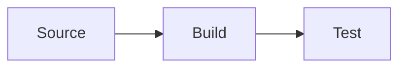

# Visual rendering fixture

This internal page verifies the Markdown components used by the documentation renderer.

## Diagrams

```svgbob "Pipeline"
+---------+     +--------+
| Source  | --> | Build  |
+---------+     +--------+
```



## Mathematics

Inline math uses $E = mc^2$.

$$\sum_{i=1}^{n} i = \frac{n(n+1)}{2}$$

## Structured content

| Field | Value |
| --- | --- |
| Status | $\checkmark$ ready |

````steps
1. **Define a workspace** [done]
   Add a task definition.
2. **Build the docs** [active]
   ```bash
   evin run docs:build
   ```
3. **Publish** [upcoming]
````

- [x] Parse Markdown
- [ ] Publish the site

timeout : duration : required
    Maximum execution time.

:Action: `evin/docs@v1`
:Output: `dist/docs/`

> [!NOTE]
> The renderer keeps semantic content accessible while activating only the required components.
