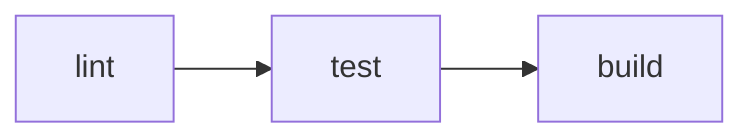

# Run your first workflow

Most projects already have commands for checks and tests. Evin does not replace
those tools; it gives the commands a shared name and makes their relationships
visible. This example uses npm scripts. Substitute commands your repository
already has.

Suppose the project has these commands:

```sh
npm run lint
npm test
npm run build
```

Today, a developer has to remember which commands to run and in what order.
You can describe that routine in `.evin/workspace.flow`:

```flow
workspace:
  name: storefront
  version: "1.0.0"
  execution: linear

stages: [Check, Build]

tasks:
  lint:
    stage: Check
    description: "Check source quality"
    run: npm run lint

  test:
    stage: Check
    description: "Run the project tests"
    needs: [lint]
    run: npm test

  build:
    stage: Build
    description: "Build the production bundle"
    needs: [test]
    run: npm run build
```

Now select the outcome you need:

```sh
evin run build
```

Evin resolves `build` and its prerequisites, then runs the commands through
ESH. The graph makes the order explicit: lint must pass before tests, and tests
must pass before the build. If a prerequisite fails, Evin stops that path and
shows which step failed.



## Inspect before running

Ask Evin to explain the selected target or plan it without executing commands:

```sh
evin explain build
evin run build --dry-run
```

Use `evin run build --verbose` to retain successful task output, or `--debug`
to include configuration and process diagnostics. These modes help answer
different questions: explain shows how the target resolves, dry-run previews
execution, and verbose/debug show details while a run proceeds.

## What Evin does—and does not do

- Evin resolves tasks and dependencies, then reports their execution.
- Your package manager and test tools still do the actual linting, testing, and
  building. The commands must exist in the environment where the workflow runs.
- ESH provides the script language for `run` steps. External commands and
  operating-system behavior remain host-dependent.
- A task graph describes ordering; it does not make the commands themselves
  portable or install missing tools.

Next: [compose tasks into workflows](/book/compose-workflows).
