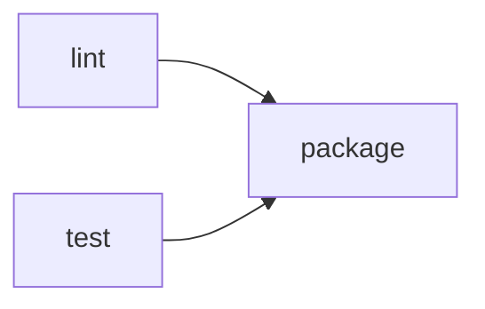

# Compose tasks into workflows

The first workflow named each command and connected them in a line. As the
project grows, the graph can reflect which work is independent and which work
needs another result first.

## Name useful outcomes

Keep a task focused on an outcome someone can select: `lint`, `test`,
`build`, or `package`. A task can run one command with `run`, or several
ordered commands and actions with `steps`:

```flow
tasks:
  test:
    stage: Test
    description: "Run unit and integration tests"
    steps:
      - run: npm run test:unit
      - run: npm run test:integration
```

Steps inside one task run in order. If the first test command fails, Evin does
not continue to the next step. Use separate tasks when a result should be
selected, reused as a dependency, or reported on its own.

## Make dependencies match the work

Consider a project where lint and tests are independent, while packaging needs
both to pass:

```flow
tasks:
  lint:
    stage: Check
    run: npm run lint

  test:
    stage: Test
    run: npm test

  package:
    stage: Publish
    needs: [lint, test]
    run: npm run package
```

The `needs` edges describe the actual requirements. Stage names group tasks
into runnable targets; their list order does not add dependencies. If lint
must finish before tests begin, add `needs: [lint]` to `test` explicitly.



Selecting `evin run package` resolves both prerequisites. If either fails,
packaging is skipped. Selecting `evin run Check` selects tasks in that stage
and still honors their declared dependencies.

## Decide whether tasks may run together

The default execution policy runs ordinary ready tasks one at a time. You can
enable parallel dispatch for the workspace or one invocation:

```sh
evin run Check --parallel
evin run Check --sequential
```

Parallel execution helps when ready tasks do not modify shared files or depend
on each other's output. Keep dependent work connected with `needs`, and keep
conflicting work sequential. Evin coordinates task-level execution; `&|` is
ESH's separate mechanism for joining commands inside one script.

## Use an action when Evin owns the capability

Some workflow steps do not need an external command. A built-in action can
create a documented artifact with explicit inputs:

```flow
tasks:
  archive:
    stage: Publish
    needs: [build]
    steps:
      - uses: evin/archive@v1
        with:
          path: dist/storefront.tar.gz
          include: [dist/storefront, LICENSE]
          prefix: storefront
          layout: relative
```

The archive action packages the paths you provide; it does not build the
application. The exact action options and output contract belong in the
[archive reference](/reference/actions/archive-action).

Next: [fit workflows to a repository](/book/fit-workflows-to-a-repository).
