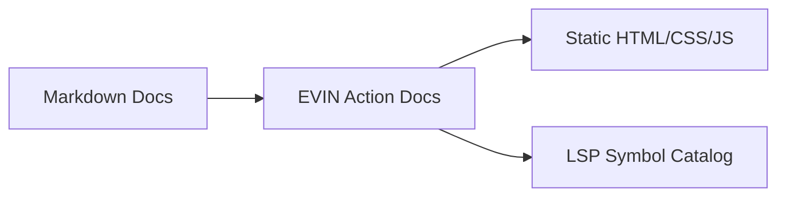

# Build a documentation site

Documentation should feel as native to the project as build and test. `evin/docs@v1` compiles Markdown and reStructuredText sources into a searchable static site, indexes content for client search, and validates internal routes and anchors before publishing.

> [!NOTE]
> **Documentation action contract**
> The `evin/docs@v1` action performs compile-time link auditing, binary search index construction, and multi-target LSP catalog compilation. See [RFC-5100: Documentation Action Specification](/reference/actions/documentation-action).

## Set up the pipeline

This repository defines documentation tasks in `docs/.evin/module.yaml`, so
their public IDs are `docs:build` and `docs:serve`. A standalone workspace can
declare equivalent root tasks in `.evin/workspace.yaml`:

```yaml
stages: [Docs]
tasks:
  build-docs:
    stage: Docs
    steps:
      - uses: evin/docs@v1
        with:
          title: My Project
          site_url: https://docs.example.com/
          source_dir: docs
          out: dist/docs
          strict_filenames: true

  serve-docs:
    stage: Docs
    steps:
      - uses: evin/docs@v1
        with:
          mode: serve
          title: My Project
          site_url: https://docs.example.com/
          source_dir: docs
          strict_filenames: true
```

- In this repository, run `evin run docs:build` for an audited build in
  `dist/docs`, or `evin run docs:serve` for a live preview.
- In the standalone example above, the corresponding targets are
  `evin run build-docs` and `evin run serve-docs`.
- Serve mode starts at `http://127.0.0.1:3000/` and tries successive ports when
  that port is occupied.

## Organize pages and sections

Structure documentation into logical folders under `docs/`. When `strict_filenames: true` is enabled, EVIN enforces numeric ordering prefixes and kebab-case slugs:

```text
docs/
├── index.md                        # Site home page (/)
├── assets/                         # Local images and media (/assets/...)
│   └── architecture.png
├── book/
│   ├── 00.index.md                 # Section overview (/book)
│   ├── 10.installation.md          # Chapter 1 (/book/installation)
│   └── 20.first-workspace.md       # Chapter 2 (/book/first-workspace)
└── reference/
    ├── 00.index.md                 # Reference overview (/reference)
    └── 10.cli-reference.1000.md    # Formal reference page with ID REF-1000
```

### Frontmatter metadata

Add YAML frontmatter to the top of each document:

```markdown
---
title: Installation
description: Build and install the EVIN CLI from this repository.
badge: "Chapter 1 · The EVIN Book"
depends_on: [REF-1000]
search_prompts:
  - "How do I install EVIN?"
  - "Initialize a workspace"
---

# Installation

Install EVIN from the checked-out Cargo workspace.
```

- `title` & `description`: Populates the page title, navigation labels, and SEO meta tags.
- `badge`: Emits an eyebrow badge directly atop the top-level heading.
- `depends_on`: Links prerequisite formal reference documents (audited at build time).
- `search_prompts`: Supplies rotating query suggestions in the search dialog.

## Craft the start page and hero spotlights

`docs/index.md` serves as the site homepage. It follows a structured layout:

1. **H1 Title**: Project headline.
2. **Lead Paragraph**: Brief overview.
3. **H2 Categories**: Section groups containing Markdown link lists that render as navigation cards.
4. **H2 Footer** (optional): Multi-column directory of project links.

```markdown
# EVIN Documentation

Define repository workflows once. Run them reliably everywhere.

## Quickstart

- [Installation](/book/installation)
- [First Workspace](/book/first-workspace)

## Architecture

- [Pipeline Lifecycle](/book/pipelines-and-hooks)
- [Documentation Engine](/reference/actions/documentation-action)

## Footer

EVIN is open-source software under the GPL-3.0 license.

### Community

- [GitHub Repository](https://github.com/example/project)
- [Issue Tracker](https://github.com/example/project/issues)
```

### Adding a hero spotlight

To feature a major call-to-action on the start page, insert a `[!SPOTLIGHT]` blockquote directly after the lead paragraph or between card sections:

```markdown
> [!SPOTLIGHT] holo | Canary
>
> ## Streamline your developer workflow.
>
> Experience instant feedback loops and reproducible task automation.
>
> [Get started today](/book/installation)
```

Matter supports 13 presentation variants: `deepspace`, `collider`, `industrial`, `genome`, `blueprint`, `crt`, `aurora`, `cyber`, `prismatic`, `brutalist`, `holo`, `geo`, and `luxury`.

### Adding an editorial feature

Use `[!FEATURE]` on the start page for a two-column editorial section. It accepts an H2, description, one or two action links, and exactly one image, video, tape, code-block, Mermaid, or Svgbob aside.

```markdown
> [!FEATURE]
>
> ## See a real shell recording
>
> Show a tested command flow alongside the next step for your reader.
>
> - [Learn terminal tapes](/reference/actions/documentation-action)
> - [Browse the book](/book)
>
> ```esh
> echo "hello from ESH"
> ```
```

Features may appear after the lead or between card sections. Matter alternates the aside placement on desktop and stacks it beneath the content on small screens. Unlike a Spotlight, a Feature has no presentation variant.

## Author rich Markdown content

EVIN provides native support for technical Markdown extensions:

### Math equations (LaTeX)

Write inline math with `$...$` and display math with `$$...$$`. Math expressions are compiled directly to accessible MathML:

```markdown
Euler's identity is defined as $e^{i\pi} + 1 = 0$.

$$
f(x) = \int_{-\infty}^{\infty} \hat{f}(\xi) \, e^{2\pi i \xi x} \, d\xi
$$
```

### Architecture diagrams

Embed static, responsive diagrams directly in code fences. EVIN renders both
**Mermaid** flowcharts/sequence diagrams and **Svgbob** ASCII-to-SVG diagrams:

````markdown

````

> [!NOTE]
> Mermaid and Svgbob diagrams are rendered as static SVG output. EVIN does not
> ship pan, zoom, editing, or other diagram interaction controls; keeping the
> output static makes it predictable, responsive, and consistent across the
> generated site.

````markdown
```svgbob
 +---------+      +------------------+      +------------+
 | docs/*.md | ---> | EVIN Docs Engine | ---> | dist/docs/ |
 +---------+      +------------------+      +------------+
```
````

### Step-by-step guides

Use the `steps` container fence to render ordered tutorial workflows with progress indicators.
Open and close the outer container with **four** backticks, not the usual
three. A step can then contain ordinary triple-backtick code fences (such as
`esh`, `yaml`, or `rust`) without prematurely closing the `steps` container:

`````markdown
````steps
### 1. Download the release binary

Fetch the latest release for your platform from GitHub Releases.

### 2. Move binary to your PATH

```esh
sudo mv evin /usr/local/bin/
```

### 3. Verify installation

```esh
evin --version
```
````
`````

> [!IMPORTANT]
> The outer fence must be longer than any fence it contains. If a `steps`
> container used three backticks, its first nested triple-backtick code block
> would terminate it and the remaining step content would be parsed incorrectly.

### Callouts and alerts

Highlight crucial information using GitHub-style alert blockquotes:

```markdown
> [!NOTE]
> Configuration files use strict YAML syntax.

> [!TIP]
> In this repository, use `evin run docs:serve` for live reloading during content authoring.

> [!IMPORTANT]
> The root `docs/index.md` requires an H1 heading and at least one card section.

> [!WARNING]
> Deprecated flags will be removed in the next major release.

> [!CAUTION]
> Modifying generated files in `dist/docs` directly will be overwritten on the next build.
```

## Add project branding

`evin/docs@v1` includes a project-neutral default appearance. To brand the documentation, place assets in `.evin/actions/docs/`:

```text
.evin/actions/docs/
├── logo.svg              # Custom header & footer SVG logo
├── favicon.svg           # Site favicon (.svg, .png, or .ico)
├── icons/                # Additional custom SVG icons
│   └── rocket.svg
└── layouts/
    └── matter/
        └── theme.scss    # Custom theme token overrides
```

## Theme and customize Matter

Choose the smallest customization level that fits the change. Matter resolves a custom layout file before its built-in counterpart, so a replacement remains narrowly scoped only when you replace the specific file you need.

| Level | Use it for | Start with |
| --- | --- | --- |
| 1. Token overrides | Colors, fonts, radii, spacing, and shell dimensions | `theme_overrides` in the action configuration |
| 2. Custom stylesheet | New selectors, `@font-face`, or CSS that has no semantic token | A complete `theme.scss` entry-point manifest |
| 3. Component replacement | Different markup or behavior for one rendered component | One file or `.evin` component under `templates/` |

### Level 1: override semantic tokens

For most branding changes, override semantic theme tokens in `theme_overrides` inside `.evin/workspace.yaml`. These values are emitted in the final CSS override layer, so no SCSS file is needed:

```yaml
- uses: evin/docs@v1
  with:
    title: My Project
    site_url: https://docs.example.com/
    theme_overrides:
      primary: "#0066cc"
      on-primary: "#ffffff"
      surface: "#f8f9fa"
      font-sans: 'Inter, system-ui, sans-serif'
      ui-radius-md: 10px
```

### Level 2: add a custom stylesheet safely

Creating `.evin/actions/docs/layouts/matter/theme.scss` shadows Matter's complete stylesheet entry point.

### Level 3: replace one component

Create an `.evin` single-file component or a same-stem `.html`, `.scss`, or `.js` file in `.evin/actions/docs/layouts/matter/templates/`.

## Validate and publish

Before publishing, EVIN validates the documentation tree:

1. **Dead Link Detection**: Verifies that every internal route and heading anchor exists.
2. **Missing Asset Auditing**: Ensures images in `/assets/` exist on disk.
3. **Diagram & Math Parsing**: Validates syntax before generating markup.

For complete field specifications, layout contracts, and presentation tokens, see the [Documentation action reference](/reference/actions/documentation-action).
