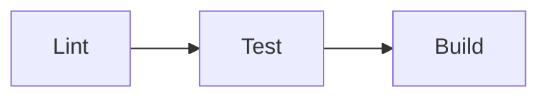

# Write project documentation

Good project documentation answers a reader's next question and gives them a
clear path to the next task. Evin turns Markdown or reStructuredText pages into
validated, route-aware data that a documentation site can render. Start with
plain Markdown; add diagrams when a picture makes a process or relationship
easier to understand.

## Organize pages around reader tasks

If the repository does not have an Evin workspace yet, run `evin init` from
its root first. For a small documentation set, keep pages directly in `docs/`:

```text
docs/
├── 00.index.md
├── 10.installation.md
├── 20.first-workflow.md
└── assets/
```

Each page needs a title and description. Ordered filenames determine sidebar
order, while the numeric prefix is left out of the public route. The index
page becomes the section landing page; for example, `20.first-workflow.md`
becomes `/first-workflow`.

```markdown
---
title: Run your first workflow
description: Connect the commands your project already uses.
---

# Run your first workflow

Explain the outcome first, then show the smallest useful example.
```

Use headings to break up long pages, links to guide readers between related
topics, and fenced blocks to show commands or configuration. Keep exact field
definitions and edge cases in reference pages; use the Book to teach a task
from start to finish. Evin checks filenames, routes, links, and anchors when
it builds the docs data.

## Show a process with a diagram

Evin renders Mermaid, Svgbob, and Pikchr fences to SVG files. The Everyinit
docs app embeds those SVGs inline, so readers can zoom them and the site theme
can style them. GitHub keeps showing the fenced source. Choose the diagram
language that makes the source easiest for your contributors to edit:



```svgbob "Input and output" id=input-output-flow
+--------+     +--------+
| Input  | --> | Output |
+--------+     +--------+
```

```pikchr "Prepare and build" id=prepare-build-flow
box "Prepare"; arrow; box "Build"
```

The optional `id=...` after the language and quoted title gives the diagram a
stable CSS hook. IDs must begin with a letter and contain only letters,
numbers, `_`, or `-`; IDs must be unique within a page. Evin generates an ID
when you omit one. A site can use the generated SVG's CSS variables to theme
one diagram:

```css
#check-build-flow {
  --diagram-ink: #14231a;
  --diagram-accent: #536b51;
  --diagram-surface: #e6ece1;
}
```

The docs build renders all three previews on this page. For more authoring
details, see the [documentation contribution guide](/contributing/documentation).
For custom frontend integrations, see the
[Everyinit npm package reference](/reference/everyinit-package).

## Keep media with the page sources

Place images and other local media under `docs/assets/`, then link them from
the page with a root-relative URL:

```markdown

```

Evin copies referenced assets into the generated data package and records
their page-specific paths. A site integration uses that asset map to load the
right file for the page. See the next chapter to connect the docs build to a
web application.

Next: [build a documentation site](/book/delivery/build-a-documentation-site).
