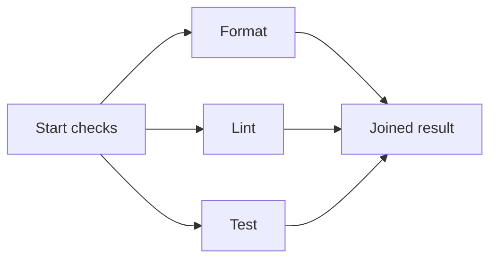

# Parallel automation

Use ESH's `&|` join for work that does not depend on another branch. Handle the
joined result in one place so failures remain visible.

## Join independent checks

```esh
{
  cargo fmt --check &| \
  cargo clippy --all-targets -- -D warnings &| \
  cargo test
} || {
  echo "Checks failed in $ESH_FAILED_CMD at line $ESH_FAILED_LINE" >&2
  exit 1
}
```

Each branch starts independently; the enclosing expression completes after all
joined work finishes. Keep commands sequential when one consumes another's
output or files.



## Put a boundary around slow work

Use `timeout` when a command needs a deadline and `retry` when failure may be
temporary. Both return a status you can handle inside the joined workflow.

```esh
timeout 30s cargo test
retry -n 3 -d 2s http GET http://127.0.0.1:8080/health
```

`timeout` returns `124` when its deadline expires. `retry` returns a non-zero status after its final failed attempt. Their exact contracts are in the [ESH Runtime Reference](/reference/esh/runtime-reference).

Next: adapt a complete pattern from [ESH automation recipes](/book/esh/automation-recipes).
