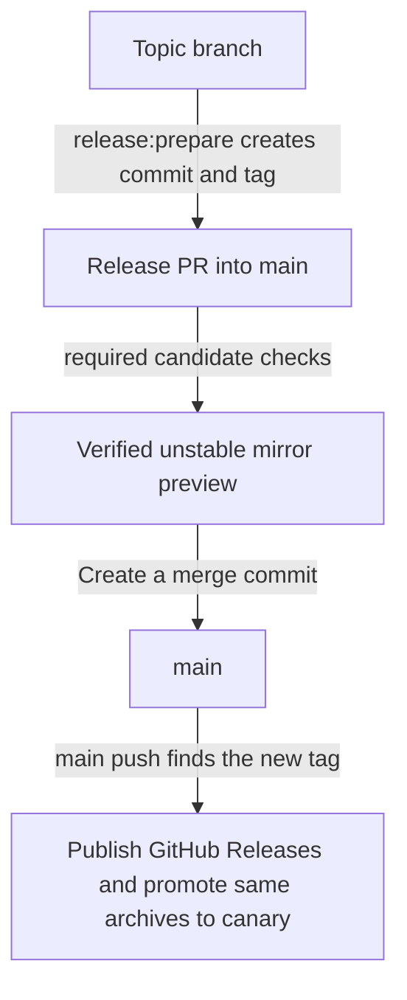

# Development workflow

Use the checked-out Evin binary for repository tasks. The `cargo evin-dev`
alias runs this source with the locked dependency graph, so it does not depend
on an installed Evin version.

## Node.js and npm

The JavaScript and TypeScript toolchain uses Node.js `22.23.3` and npm
`10.9.9`. The root `.node-version` file is the version source for local Node
version managers, GitHub Actions, and Cloudflare Pages. Node.js includes the
matching npm version; do not upgrade npm globally. `package.json` also declares
and checks both versions so setup fails clearly when the active toolchain
differs.

Select the repository's Node version with a version manager that reads
`.node-version` (for example, `mise`, `fnm`, or `nvm`), then run the Evin
bootstrap task below. It installs dependencies with `npm ci` from the tracked
`package-lock.json`. Use `npm ci` when refreshing a local install. Use
`npm install` only when intentionally changing dependencies and the lockfile.

CI reads `.node-version` and runs the same bootstrap task. Cloudflare Pages
also reads `.node-version` and installs the dependencies from the npm lockfile
before running `npm run build`. Wrangler builds Workers for Cloudflare's
`workerd` runtime, while Node.js runs the local JavaScript and TypeScript
tooling.

## Find and run tasks

```esh
cargo evin-dev list
cargo evin-dev explain verify
cargo evin-dev run doctor
cargo evin-dev run bootstrap
```

`doctor` reports host prerequisites. `bootstrap` fetches locked Rust and npm
dependencies, installs Playwright Chromium, and synchronizes the workspace.
It expects the pinned Node.js/npm versions to be active; it does not install
the host toolchains. Run it once after checkout or when dependencies change.

The local npm commands delegate to these same tasks: `docs:build`,
`test:docs-responsive`, and `verify` already call their Evin targets;
`pages:dev`, `installer:dev`, `mirror:dev`, and `mirror:seed` use the `infra`
module. The Cloudflare Pages `build` command remains a bootstrap adapter that
installs this checkout's Evin CLI before calling `docs:build`.

The infra module includes topic-specific namespaces. `infra:quality` owns
Worker type generation, formatting, linting, type checking, and Wrangler
builds; `infra:dev` owns local servers; `infra:mirror` owns mirror metadata and
R2 publication; and `infra:deploy` owns intentional production Worker deploys.
Run `cargo evin-dev run infra:quality:types` after changing a Wrangler
configuration, `cargo evin-dev run infra:quality:verify` for the complete infra
validation gate, and `cargo evin-dev run infra:deploy:workers` to deploy both
Workers after Cloudflare authentication. Workspace `quality` includes the
verification gate.

Tasks stay focused: `build`, `check`, `fmt`, `lint`, and `test` do not call one
another. `quality` runs Rust checks, formatting, Clippy, documentation
validation, and infra verification; `verify` adds the workspace test suite. Use
a leaf task while iterating and `verify` before sending a change for review:

```esh
cargo evin-dev run build
cargo evin-dev run check
cargo evin-dev run fmt
cargo evin-dev run lint
cargo evin-dev run test
cargo evin-dev run e2e
cargo evin-dev run quality
cargo evin-dev run verify
```

For a focused binary change, use its module tasks. `verify` composes that
binary's check, Clippy, and tests; `e2e` runs its end-to-end suite.

```esh
cargo evin-dev run evin:test
cargo evin-dev run evin:e2e
cargo evin-dev run evin:verify

cargo evin-dev run esh:test
cargo evin-dev run esh:e2e
cargo evin-dev run esh:verify
cargo evin-dev run esh:lsp
```

GitHub Actions currently runs on Linux only. Pull requests into `release` run
workspace tests, Evin and ESH binary E2E suites, quality checks, and a full
distribution rehearsal. Other pull requests into `main` use the same full
checks; a promotion PR from the repository's `release` branch uses the lighter
promotion gate. Merged PR pushes do not repeat the checks. A direct or bypass
push runs the full gates. The weekly schedule runs process-supervision soak
tests on Linux; a manual dispatch can also request that soak suite with
`run_soak`.

## Platform support

Linux is the supported platform for local development, contributor workflows,
CI, and release artifacts. macOS and Windows are not currently tested in the
GitHub workflows. See the root [CI and platform policy on GitHub](https://github.com/dukasn/everyinit/blob/main/CI.md)
for how support may expand.

## Debug task runs

Add Evin's global `--verbose` or `--debug` flag before `run`. Verbose mode
reports created archives and their sizes; debug mode includes structured
diagnostics and action-specific details. To inspect one binary's native
package inputs, provide a matching tag, version, and release target:

```sh
export RELEASE_TAG=v1.0.0-canary.100
export RELEASE_VERSION=1.0.0-canary.100
export RELEASE_CHANNEL=unstable
export RELEASE_TARGET=x86_64-unknown-linux-musl
cargo evin-dev --verbose run evin:package:native
cargo evin-dev --debug run evin:package:native
```

Debug mode lists selected files, their sizes and modes, and each artifact's
input and output sizes. These commands build only Evin and overwrite its
artifacts under `dist/`. Replace `evin` with `esh` to inspect ESH. For the
Cloudflare tar.gz task, use `evin:package:cloudflare` or
`esh:package:cloudflare` instead.

To exercise the archive action's format encoders without building release
binaries, run its Rust tests:

```sh
cargo test --locked -p evin-action-archive
```

## Documentation loop

```esh
cargo evin-dev run docs:build
cargo evin-dev run docs:test-responsive
cargo evin-dev run docs:verify
cargo evin-dev run docs:serve
```

`docs:serve` rebuilds documentation content as it changes and restarts the
server when its task watcher sees implementation or configuration changes.
For a temporary network preview, pass an argument to the task:

```esh
cargo evin-dev run docs:serve -- --host
```

See [writing documentation](/contributing/documentation) for page structure,
content conventions, and catalog updates.

## Build and inspect release packages

Release artifacts are Linux `x86_64-unknown-linux-musl` binaries. Install the
Rust target and musl linker prerequisites reported by `release:doctor` before
building. Each binary module owns its packaging tasks. Cloudflare currently
uses only the tar.gz format; run a single binary's Cloudflare package check
with its current version and target:

```esh
RELEASE_VERSION=1.0.0-canary.100 \
RELEASE_TARGET=x86_64-unknown-linux-musl \
cargo evin-dev run evin:package:cloudflare-verify
```

Use `esh:package:cloudflare-verify` for ESH. These tasks build and validate
only the selected binary's tar.gz artifact. The Cloudflare mirror metadata
continues to list and sign only those tar.gz artifacts.

GitHub release packaging builds all formats supported by `evin/archive@v1`:
tar.gz, DEB, APK, and Arch `.pkg.tar.zst`. To build and verify one binary's
complete set locally, run:

```esh
RELEASE_TAG=v1.0.0-canary.100 \
RELEASE_VERSION=1.0.0-canary.100 \
RELEASE_TARGET=x86_64-unknown-linux-musl \
cargo evin-dev run evin:package:verify
```

Use `esh:package:verify` for ESH. The read-only version-bumper task derives
release metadata without changing the worktree, so these local package tasks
can run without creating a commit, tag, or release lock. The tasks build and
stage only the selected binary, create all four formats, and verify the files.
Artifacts stay in the owning crate's workspace:

```text
crates/
+-- evin/
|   \-- dist/
|       +-- github/
|       |   \-- evin-v<version>-x86_64-unknown-linux-musl.tar.gz
|       \-- packages/
|           +-- evin_<version>-<revision>_amd64.deb
|           +-- evin-<version>-r<revision>.apk
|           \-- evin-<version>-<revision>-x86_64.pkg.tar.zst
\-- esh/
    \-- dist/
        +-- github/
        |   \-- esh-v<version>-x86_64-unknown-linux-musl.tar.gz
        \-- packages/
            +-- esh_<version>-<revision>_amd64.deb
            +-- esh-<version>-r<revision>.apk
            \-- esh-<version>-<revision>-x86_64.pkg.tar.zst
```

For the complete tagged GitHub release package set, use the workspace task.
It checks the release version, runs the repository test suite, then builds and
verifies all formats for both binaries:

```esh
RELEASE_TAG=v1.0.0-canary.100 \
RELEASE_VERSION=1.0.0-canary.100 \
RELEASE_TARGET=x86_64-unknown-linux-musl \
cargo evin-dev run release:package-verify
```

Each tar.gz contains its matching `bin/` executable, `LICENSE`,
`THIRD_PARTY_NOTICES.md`, and `LICENSES/` beneath a versioned directory. Native
packages install the executable under `/usr/bin` and the license and
third-party notices under `/usr/share`. `release:package` orchestrates both module package sets, while
`release:package-verify` verifies the GitHub artifacts. The separate
`release:package-cloudflare-verify` target checks only the two tar.gz files.

## Versioning and release labels

The package version and Git tag identify a build: for example,
`1.0.0-canary.101` and `v1.0.0-canary.101`. Evin calculates these from tagged
history and release rules. The human-facing release label is independent: it
is a plain configured string and has no numbering, sequencing, or relationship
to SemVer.

Set the shared label once in `.evin/workspace.flow` under top-level `values`:

```flow
values:
  release_label: "Alpha"
```

That value is only used where the release task configuration passes
`${release_label}`. In the current release flow those destinations are the
generated changelog heading, release commit body, GitHub release title, and
mirror `release.json`. The release script verifies the configured label in
both rehearsal and canonical changelogs. Remove or change an individual use to
control that destination. Artifact filenames, native package versions, binary
`--version` output, and Git tags continue to use the semantic version.

The example value is illustrative. Set a new `release_label` for each release.
Candidate checks require it to be nonempty and different from the previous
release label. Evin does not generate or sequence labels. Version strings shown
elsewhere in this guide are illustrative; check the current release state
before using them.

## Prepare a canary release

The release pull request is the candidate. Its required checks build both
portable archives, publish them to the opt-in unstable mirror lane, and verify
that the public installer can fetch and install them. Merging the pull request
into `main` publishes those same archive bytes to GitHub Releases and promotes
them to the canary mirror lane. There is no second manual publish dispatch.



### Before starting

- Confirm `main` is current and your working tree is clean.
- Confirm the `release-candidate` pull request label exists in GitHub. Add it
  to the release PR to start the candidate build.

### 1. Prepare the tagged candidate

Start a clean topic branch from the latest remote `main`:

```sh
git fetch origin
git switch --create feat/release-alpha-02 origin/main
cargo evin-dev run release:doctor
```

`release:doctor` reports whether the local machine has the prerequisites for
Linux musl packaging. Before preparing the release commit, you can run the
read-only distribution rehearsal for early feedback. It writes the candidate
changelog under ignored `target/`, builds and checks all formats for Evin and
ESH, verifies license materials and checksums, and needs no signing key:

```sh
export RELEASE_VERSION="$(node scripts/release/workspace-version.mjs)"
export RELEASE_TARGET=x86_64-unknown-linux-musl
cargo evin-dev run release:distribution-rehearsal
```

Update top-level `values.release_label` in `.evin/workspace.flow` to the new human-facing label
for this candidate. Then prepare the version, changelog, release commit, and
annotated tag:

```sh
cargo evin-dev run release:prepare
```

Changelog verification reads the prepared version from `Cargo.toml` and
`.evin/workspace.flow` and requires them to agree. Action output templates such
as `${release:bump.version}` belong in action `with:` blocks; `run:` commands
use ESH shell expansion.

Task environments are isolated. GitHub publishing tasks explicitly forward
`GITHUB_REPOSITORY`, `GITHUB_TOKEN`, and optional API and summary settings to
the publishing script. Mirror metadata tasks also forward `RELEASE_COMMIT`
and `RELEASE_BASE_URL` so source identity and mirror URL overrides survive
the task boundary.

The task calculates the package version and matching `v` tag. Candidate checks
require that the annotated tag points to the exact candidate commit, the
version advances beyond the previous release, and the label differs from the
previous release label. The task creates the release commit and tag locally.
Push both the branch and tag, then open a PR into `main`:

```sh
git push --set-upstream origin HEAD
git push origin "$(git describe --tags --exact-match HEAD)"
gh pr create --base main
```

Apply the `release-candidate` label. The candidate workflow builds and verifies
the two tar.gz archives. A trusted follow-up workflow signs preview metadata,
publishes immutable candidate objects to the unstable R2 bucket, fetches them
back through `dl.everyinit.dev`, checks signatures and checksums, and runs the
installer against the exact candidate version. The required `Unstable preview`
check passes only after those steps finish.

Early testers can opt into the unstable lane. It is separate from canary, so
preview publication does not change the version ordinary canary users receive.
The unstable pointer covers Evin and ESH together and updates only after both
archives are reachable and installable.

### 2. Merge and publish

After all required PR checks pass and the candidate has been reviewed, merge
with GitHub's **Create a merge commit** option. The candidate tag points to a
commit inside the PR, so that commit must remain in `main` history. Do not
squash or rebase the release PR. The main-branch workflow detects the newly
reachable tag, confirms that the `Unstable preview` check passed for its exact
commit, fetches the unstable archives, and verifies them again.

It then uses those same archive bytes to create the Evin and ESH GitHub
Releases, publishes channel-specific canary metadata, and moves the single
canary pointer last. It does not rebuild binaries after merge. If any required
artifact is missing or the preview check did not pass, publication stops.

```sh
PR_NUMBER=123
gh pr merge "$PR_NUMBER" --merge
```

Only the two `.tar.gz` archives are published to the mirror and attached to
GitHub Releases. Debian, Alpine, and Arch packages remain separate build and
verification outputs. The configured label appears in the changelog, release
commit, GitHub release title, and signed mirror metadata. Both `unstable` and
`canary` are prerelease channels; there is no `latest` channel.

## Sign distribution metadata and test the mirror locally

The Linux mirror metadata signs the exact tar.gz `SHA256SUMS` bytes with an
Ed25519 key. It does not include the DEB, APK, or Arch artifacts. The first
GitHub Release also carries only the two tar.gz archives; native package
publication is deferred until package repository signing and keyring setup are
ready.
The matching public key is pinned in `infra/get/release-key.pub`; the private
key must match it and stay outside the repository. Set the version, target,
and key path before preparing the local mirror:

```sh
export RELEASE_VERSION=1.0.0-canary.100
export RELEASE_CHANNEL=unstable
export RELEASE_TARGET=x86_64-unknown-linux-musl
export RELEASE_SIGNING_KEY_FILE="$HOME/.config/everyinit/release-key.pem"
npm run mirror:seed
```

`mirror:seed` delegates to `infra:mirror:seed`. Its task dependencies build
and verify both Cloudflare archives, generate and sign both manifests, then
seed the local preview and release R2 buckets. The same task can be run
directly with `cargo evin-dev run infra:mirror:seed`. Use
`cargo evin-dev run infra:mirror:metadata` to generate signed local metadata.

The installer verifies the signature before it checks the archive checksum or
extracts the files. Do not rotate the private key without also updating the
pinned public key in the installer.

After installing locked npm dependencies with `npm ci` and preparing the
mirror as above, run the local Workers in separate terminals:

```sh
npm run mirror:seed
npm run mirror:dev
curl -i http://localhost:8787/unstable.json
```

```sh
npm run installer:dev
curl -fsS http://localhost:8789/evin | sh -s -- --help
curl -fsS http://localhost:8789/evin | sh -s -- --package evin --channel unstable \
  --prefix "${TMPDIR:-/tmp}/everyinit-installer-smoke"
```

The local mirror serves the metadata and archives from the seed. The installer
script supports Linux x86_64 and installs into `~/.local` by default. Local
Cloudflare state is stored beneath `.wrangler/state`.

The release workflow publishes verified R2 objects after the release PR
merges into `main`; the GitHub Release and mirror pointer updates use the same
verified tar.gz files. The Worker code itself still needs an initial Cloudflare
deployment and the DNS domains must be active. See
[Cloudflare and GitHub release setup](/contributing/release-infrastructure) for the required
account and repository settings.

## Refresh the ESH runtime catalog

The ESH runtime catalog is generated and tracked. Regenerate it intentionally
after changing the ESH runtime reference:

```esh
cargo evin-dev run docs:catalog
```

## Keep project work in EVIN

Declare repository work as EVIN tasks before a forge workflow uses it. GitHub
Actions provisions checkout state, toolchains, operating-system packages,
credentials, matrices, and publishing; its project step invokes the same EVIN
target used locally. Cloudflare bootstraps the checked-out CLI and delegates
the documentation build to `docs:build`.
