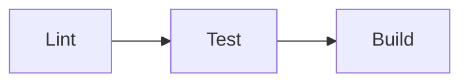

# Documentation

Documentation changes should help a reader complete a task or understand a
contract. Keep each page focused, use the language readers see in the product,
and validate links and examples before review.

## Choose the right page

- Put onboarding and task-based explanations in the Book under `docs/book/`.
- Put exact configuration, command, diagnostic, and built-in action behavior in
  `docs/reference/`.
- Put project contributor instructions in `docs/contributing/`.
- Put a short project introduction and primary routes in `docs/index.md`.

Do not duplicate a full reference in a tutorial. Explain the decision or task,
then link to the reference for exact fields and behavior.

## Add or edit a page

Each public Markdown page needs `title` and `description` frontmatter. File
names set section order and public routes: use
`<order>.<kebab-case-name>.md`, with `00.index.md` for each section overview.
For example, `docs/book/25.handle-errors.md` becomes
`/book/handle-errors`. Reference filenames can include their stable numeric ID,
such as `90.language-reference.3000.md`; the ID is omitted from the public URL.

Link to generated routes with root-relative paths, for example
`/reference/cli-reference`. Prefer links to existing pages over repeating
their content. Add local images under `docs/assets/` and use their public path,
such as `/assets/diagram.png`.

## Write examples readers can use

Use GitHub Flavored Markdown so pages remain readable in the repository and on
the site. Label code fences with the language when it helps. Evin and ESH
examples use `flow` and `esh`; keep examples current with the parser and the
documented version. Use Mermaid, Svgbob, or Pikchr fences for diagrams. The
hosted docs site renders them as inline SVG, while GitHub keeps the source
visible. Give a diagram an `id=...` only when its CSS needs a stable target:

````markdown

````

Use headings to break up longer procedures, numbered steps when order matters,
and GitHub alerts sparingly for short notes or warnings. Avoid site-only cards,
tabs, or custom fence attributes; they do not travel well to GitHub or other
Markdown viewers.

## Keep generated data in sync

Markdown is the source for generated docs routes and search data. Run the docs
build after changing pages:

```sh
cargo evin-dev run docs:build
```

If you change a configuration or ESH reference that feeds a tracked editor or
runtime catalog, regenerate it through its owning task:

```sh
cargo evin-dev run docs:evin-catalog
cargo evin-dev run docs:esh-catalog
```

Review generated catalog diffs with the source change. Do not edit build output
under `dist/docs-data` directly.

## Change the documentation website

The Astro site lives in `apps/everyinit/`; the framework-neutral docs package
is in `packages/everyinit/`. Keep site interface strings in the site's Fluent
catalogs and source documentation translations in matching docs pages. Run the
site checks when changing site rendering or navigation:

```sh
cargo evin-dev run site:verify
cargo evin-dev run site:e2e
```

Use `cargo evin-dev run site:dev` for live editing or
`cargo evin-dev run site:preview` to inspect a built site with Cloudflare Pages
routing. The [site README](https://github.com/dukasn/everyinit/blob/main/apps/everyinit/README.md)
documents local URLs and focused checks.
