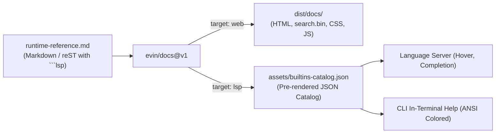

# Documentation action

> **RFC-5100 · Implemented interface**
>
> Action identifier: `evin/docs@v1`

`evin/docs@v1` compiles Markdown and reStructuredText sources into a fast, searchable static documentation site. It validates internal routes, anchors, assets, and diagrams before emitting the site. See [Build a documentation site](/book/documentation-site) for a hands-on tutorial.

Mermaid and Svgbob blocks compile to static, responsive SVG markup. The action
does not add pan, zoom, editing, or browser-side diagram controls; this is an
intentional consistency and responsiveness boundary.

```tape title="Inspect a shell session" rows=10 cols=46 speed=200ms
type "pwd"
enter
wait
```


## Configuration

| `with` field | Default | Purpose |
| --- | --- | --- |
| `site_url` | required | Production canonical URL used for canonical links, sitemaps, and `robots.txt`. |
| `mode` | `build` | Execution mode: `build` generates static files; `serve` starts a local preview server with live reloading. |
| `target` | `web` | Output format: `web` generates HTML documentation; `lsp` produces a machine-readable JSON catalog. |
| `title` | optional | Site title displayed in the header, sidebar, and metadata. Inferred from root start page if omitted. |
| `language` | `en` | HTML language tag set on emitted documents. |
| `source_dir` | `docs` | Documentation source directory. |
| `out` | `dist/docs` | Output directory for built assets. |
| `asset_dir` | `assets` | Image and media directory relative to `source_dir`. |
| `extensions_dir` | `.evin/actions/docs` | Project extension directory for custom branding, layouts, and icons. |
| `layout_dir` | optional | Custom layout directory. When set, shadows built-in layout templates. |
| `logo` | optional | Path to a custom SVG project logo. |
| `favicon` | optional | Path to a custom favicon (`.svg`, `.png`, or `.ico`). |
| `icon_dir` | optional | Path to custom SVG icons merged into the site icon sprite. |
| `theme` | `matter` | Layout theme identifier. |
| `theme_overrides` | `{}` | Map of semantic UI token overrides (e.g. `primary: "#0066cc"`). |
| `theme_color` | optional | PWA theme color meta tag. |
| `background_color` | optional | Web manifest background color. |
| `bundle` | `separated` | Packaging mode: `separated` emits distinct HTML, CSS, and JS; `single-file` inlines the site into standalone page files. |
| `minify` | build default | Minify emitted CSS and JavaScript. Defaults to `true` in `build` mode and `false` in `serve` mode. |
| `port` | `3000` | Local HTTP server port for `serve` mode. |
| `strict_filenames` | `false` | Enforce EVIN ordering prefixes and kebab-case file naming conventions. |
| `reference_prefix` | `REF` | Prefix used for formal reference identifiers (e.g. `REF-4500`). |
| `validate_links` | `true` | Check internal routes and heading anchors for dead links. |
| `extract_frontmatter` | `true` | Parse YAML frontmatter or RST metadata directives. |
| `include` | `[]` | Glob patterns to include from `source_dir`. |
| `exclude` | `[]` | Glob patterns to exclude from `source_dir`. |
| `topbar` | unset | Fallback announcement configuration applied when the root page does not define one. |
| `presentation` | unset | Default presentation settings and fallback theme variant. |

```yaml
tasks:
  build-docs:
    stage: Docs
    steps:
      - uses: evin/docs@v1
        with:
          site_url: https://docs.example.com/
          title: My Project
          source_dir: docs
          out: dist/docs
          strict_filenames: true
          bundle: separated
```

## Semantic theme overrides

Use `theme_overrides` for ordinary branding changes. EVIN appends these declarations in the final `@layer overrides`, so they win over Matter defaults, dark-mode values, and component styles without requiring a custom stylesheet. Keys may use hyphens or underscores (`font-mono` and `font_mono` are equivalent); a leading `--` is also accepted.

The table lists accepted YAML keys and the canonical property emitted into the final stylesheet. Use CSS values appropriate for the property: colors, CSS lengths, easing functions, or complete font-family stacks.

### Colors

| YAML key | Canonical CSS property | Role | Default |
| --- | --- | --- | --- |
| `primary` or `ui-primary` | `--ui-color-primary` | Primary actions and accents | `#332E2A` |
| `on-primary` or `ui-on-primary` | `--ui-color-on-primary` | Text and icons on primary surfaces | `#FFFBF7` |
| `surface` or `ui-surface` | `--ui-color-surface` | Standard raised surface | `#F2ECE4` |
| `ui-bg` | `--ui-color-background` | Page background | `#F8F6F2` |
| `ui-on-bg` | `--ui-color-on-background` | Page foreground | `#1D1B19` |
| `ui-surface-variant` | `--ui-color-surface-variant` | Alternate surface | `#EAE3D9` |
| `ui-surface-container-lowest`, `ui-surface-container-low`, `ui-surface-container`, `ui-surface-container-high`, `ui-surface-container-highest` | matching `--ui-color-surface-container-*` | Tonal container scale | Matter tonal scale |
| `ui-on-surface`, `ui-on-surface-variant` | matching `--ui-color-on-surface*` | Surface foreground and muted foreground | `#1D1B19`, `#524B43` |
| `ui-outline`, `ui-outline-variant` | matching `--ui-color-outline*` | Borders and separators | `#C0B7AA`, `#DDD6CC` |
| `ui-hover` | `--ui-color-state-hover` | Hover state overlay | `rgb(51 46 42 / 0.07)` |
| `ui-link`, `ui-link-hover` | matching `--ui-color-link*` | Link foreground and hover foreground | `#24201D`, `#0E0D0C` |
| `ui-code-bg`, `ui-code-text` | `--ui-color-code-surface`, `--ui-color-code-on-surface` | Code-block surface and text | `#ECE5DC`, `#1D1B19` |
| `ui-banner-bg`, `ui-banner-text`, `ui-banner-badge-bg`, `ui-banner-badge-text`, `ui-banner-border` | matching `--ui-color-banner-*` | Default banner surface, foreground, badge, and border | Matter banner palette |

### Typography, shape, and motion

| YAML key | Canonical CSS property | Role | Default |
| --- | --- | --- | --- |
| `font-sans` | `--ui-typescale-font-sans` | Default interface and prose family | System sans-serif stack |
| `font-mono` | `--ui-typescale-font-monospace` | Code, keyboard hints, references, and technical presentation text | IBM Plex Mono, then system monospace fallbacks |
| `ui-radius-xs`, `ui-radius-sm`, `ui-radius-md`, `ui-radius-lg`, `ui-radius-xl`, `ui-radius-full` | `--ui-shape-corner-extra-small`, `--ui-shape-corner-small`, `--ui-shape-corner-medium`, `--ui-shape-corner-large`, `--ui-shape-corner-extra-large`, `--ui-shape-corner-full` | Corner scale | `4px`, `8px`, `12px`, `16px`, `24px`, `9999px` |
| `ease`, `duration` | `--ui-motion-easing-standard`, `--ui-motion-duration-medium` | Default transitions | `cubic-bezier(0.2, 0, 0, 1)`, `300ms` |

### Layout and spacing

| YAML key | Canonical CSS property | Role | Default |
| --- | --- | --- | --- |
| `sidebar-width` | `--ui-layout-sidebar-width` | Desktop navigation width | `280px` before responsive expansion |
| `content-max-width` | `--ui-layout-content-max-width` | Maximum reading-column width | `840px` |
| `header-h` | `--ui-layout-header-height` | Header height and scroll offset | `64px` |
| `ui-space-1`, `ui-space-2`, `ui-space-3`, `ui-space-4`, `ui-space-5`, `ui-space-6` | matching `--ui-ref-space-<n>` | Small spacing scale | `4px`, `8px`, `12px`, `16px`, `20px`, `24px` |
| `ui-space-8`, `ui-space-12`, `ui-space-16` | matching `--ui-ref-space-<n>` | Large spacing scale | `32px`, `48px`, `64px` |
| `spacing-paragraph-bottom`, `spacing-heading-top`, `spacing-heading-bottom`, `spacing-section-gap`, `spacing-card-padding`, `spacing-inline-gap` | matching `--ui-doc-spacing-*` | Documentation rhythm | Fluid Matter spacing values |

The spacing aliases are deliberately discrete; `ui-space-7`, `ui-space-9`, `ui-space-10`, and `ui-space-11` are not predefined. For a specialized token outside this public set, use its full CSS custom-property name in `theme_overrides` or add it in a Level 2 stylesheet.

## Project extensibility and asset resolution

`evin/docs@v1` is strictly project-neutral: it ships with no hard-coded project branding. Custom branding and presentation assets are resolved using a four-tier precedence model:

1. **Explicit `with:` input** in task configuration.
2. **Conventional extension file** inside `.evin/actions/docs/`.
3. **Built-in theme asset** from the active theme.
4. **Neutral fallback** (e.g., text document symbol if no logo is provided).

```text
.evin/actions/docs/
├── logo.svg
├── favicon.svg
├── icons/
│   └── custom-icon.svg
└── layouts/
    └── matter/
        ├── shell.html
        ├── theme.scss
        ├── app.js
        └── templates/
            ├── presentation.html
            └── presentation.scss
```

| Asset | Explicit field | Extension path | Fallback |
| --- | --- | --- | --- |
| Project Logo | `with.logo` | `.evin/actions/docs/logo.svg` | Neutral text symbol `🕮` |
| Favicon | `with.favicon` | `.evin/actions/docs/favicon.svg` (`.png`, `.ico`) | Neutral document icon |
| Custom Icons | `with.icon_dir` | `.evin/actions/docs/icons/*.svg` | Standard navigation icons |
| Layout Overrides | `with.layout_dir` | `.evin/actions/docs/layouts/<theme>/` | Built-in Matter templates |
| Declarative Token Overrides | `with.theme_overrides` | - | Matter semantic tokens |
| Theme Stylesheet | `with.layout_dir` | `.evin/actions/docs/layouts/<theme>/theme.scss` | Built-in Matter stylesheet entry point |

## Custom layouts and components

Layouts can be extended or shadowed at component granularity. Projects only need to supply the specific files they wish to override.

### Component formats

Components can be authored in two formats:

1. **Single-File Component (`.evin`)**: Combines markup, scoped Sass, and client script in one file:
   ```html
   <template>
     <aside class="custom-callout" data-kind="{{kind}}">
       {{#if title}}
       <div class="callout-header">
         <span class="callout-title">{{title}}</span>
       </div>
       {{/if}}
       <div class="callout-body">{{{content}}}</div>
     </aside>
   </template>
   <style lang="scss" scoped>
     .custom-callout {
       border: 1px solid var(--ui-color-outline);
       border-radius: var(--ui-shape-corner-medium);
       padding: var(--ui-ref-space-4);
     }
   </style>
   <script>
     // Component client logic (bundled only when the component is used)
   </script>
   ```

   - `{{var}}`: Escaped dynamic variable.
   - `{{{var}}}`: Raw unescaped HTML variable (e.g. `{{{content}}}`).
   - `{{#if condition}} ... {{/if}}`: Conditional template block.
   - `<style scoped>`: Scoped SCSS automatically compiled into native CSS `@scope ([data-c-<name>])`.

2. **Component Triad**: Co-located `<name>.html`, `<name>.scss`, and `<name>.js` files placed inside the `templates/` directory.

### Shadowable layout templates

| Template | Purpose |
| --- | --- |
| `shell.html` | Root document wrapper with navigation drawers, header toolbar, search dialog, and content slots. |
| `theme.scss` | Theme token definitions, color mappings, and typography scales. |
| `app.js` | Client-side navigation, search indexing, responsive drawer, and keyboard controllers. |
| `templates/presentation.html` | Presentation container for Topbars and Spotlight hero banners. |
| `templates/presentation.scss` | Sizing scales and surface styles for presentation variants. |
| `templates/toc_block.html` | Table of contents outline rail and mobile outline drawer. |
| `templates/code_block.html` | Syntax-highlighted code blocks with line numbers and copy buttons. |
| `templates/diagram_mermaid.html` / `templates/diagram_svgbob.html` | Mermaid and Svgbob diagram rendering containers. |
| `templates/footer.html` | Structured documentation footer columns. |

Custom shells must provide the required slot placeholders:
- `<topbar></topbar>`: Slot for the top announcement banner.
- `<content></content>`: Main document body insertion point.
- `<outline-inline></outline-inline>` / `<outline-rail></outline-rail>`: Table of contents navigation slots.

## Presentation surfaces and theme variants

Matter provides 13 distinct visual presentation variants for Topbars and Spotlight banners:

| Variant | Aesthetic & Palette | Recommended Use |
| --- | --- | --- |
| `deepspace` | Obsidian black, deep navy, electric blue | General announcements, stable releases |
| `collider` | Dark steel, radiant cyan glow | Performance milestones, technical benchmarks |
| `industrial` | Charcoal carbon, hazard amber stripes | Deprecations, maintenance notices, breaking changes |
| `genome` | Slate teal, bio-luminescent neon cyan | Experimental features, beta testing channels |
| `blueprint` | Precision grid lines, cyan architectural ink | Architectural decisions, API specifications |
| `crt` | Scanline raster, phosphorus phosphor green | Terminal tooling, low-level runtime updates |
| `aurora` | Shifting northern lights violet-teal gradient | Major version launches, community highlights |
| `cyber` | Dark matrix, sharp acid-green accents | Security advisories, vulnerability disclosures |
| `prismatic` | Multidimensional spectral refracted gradients | Design systems, visual gallery overviews |
| `brutalist` | High-contrast neon yellow `#DFFF1A`, jet black | Critical alerts, urgent actions required |
| `holo` | Iridescent metallic foil, lavender-cyan shimmer | Canary releases, featured spotlight showcases |
| `geo` | Isometric geometric tessellation, magenta | Ecosystem updates, plugin announcements |
| `luxury` | Rich onyx, metallic satin gold borders | Enterprise features, LTS stability guarantees |

### Sizing scales

Presentation elements strictly decouple compact header banners from large hero sections using scale tokens:

- **Compact Scale (`.presentation-scale-compact` / Topbar)**: Max height `40px`–`44px`. Uses `--topbar-action-font-size`, `--topbar-action-icon-size` (`1rem`), and `--topbar-badge-font-size` (`0.6875rem`).
- **Feature Scale (`.presentation-scale-feature` / Spotlight)**: Hero banner with responsive min-height `clamp(320px, 38vw, 460px)`. Uses `--spotlight-action-font-size`, `--spotlight-action-icon-size` (`1.25rem`), and `--spotlight-badge-font-size`.

### Presentation tokens

| Custom property | Role |
| --- | --- |
| `--presentation-surface` | Background fill for the presentation layer. |
| `--presentation-ink` | Main body text foreground color. |
| `--presentation-outline` | Border and separator stroke color. |
| `--presentation-action-surface` | Call-to-action button background fill. |
| `--presentation-action-ink` | Call-to-action button text and icon color. |
| `--presentation-badge-surface` | Tag/badge background fill. |
| `--presentation-badge-ink` | Tag/badge text foreground color. |
| `--topbar-close` | Dismiss button icon and hover ring color. |

## Start page, spotlights, and topbars

### Start page structure

The root `docs/index.md` (or `index.rst`) defines the site home page. It follows a structured semantic contract:

1. **H1 Title**: Project headline.
2. **Lead Paragraph**: Introductory mission statement.
3. **H2 Sections**: Card categories containing unordered lists of internal links.
4. **H2 Spotlight** (optional): Large interactive call-to-action.
5. **H2 Footer** (optional): Multi-column link directory.

```markdown
# EVIN Documentation

Build, test, and release software with unified task pipelines.

## The EVIN Book

- [Installation](/book/installation)
- [First Workspace](/book/first-workspace)
- [Documentation Site](/book/documentation-site)
- [Pipelines and Hooks](/book/pipelines-and-hooks)

## Footer

EVIN is open-source under the GPL-3.0 license.

### Project

- [Source](https://github.com/example/project)
- [Releases](https://github.com/example/project/releases)
```

### Spotlight blockquotes

Add a hero banner to the start page using a `[!SPOTLIGHT]` blockquote:

```markdown
> [!SPOTLIGHT] holo | Canary
>
> ## Ready for the next generation?
>
> Experience real-time task pipelines and automated release management.
>
> [Explore the book](/book)
```

Spotlight rules:
- Must specify a valid variant (`holo`, `cyber`, `brutalist`, etc.).
- An optional badge text is appended with `| <Badge>`.
- Must contain exactly one H2 heading, one plain paragraph, and one Markdown CTA link.

### Feature blockquotes

Use `[!FEATURE]` for a start-page editorial section with copy, Matter-styled primary and secondary actions, and one rich aside. Unlike Spotlight, Feature uses the standard Matter surface and has no presentation variant. Multiple Features may appear after the lead paragraph or between card sections; their asides alternate right then left on wide screens and stack below the copy on narrow screens.

A Feature must contain exactly one H2, one non-empty description paragraph, an unordered list of one or two links, and one final aside. The first link is primary and the optional second link is secondary. Supported asides are a standalone image, video, `tape`, fenced code block, or Mermaid/Svgbob diagram. FEATURE is accepted only on `docs/index.md` or `docs/index.rst`; it is rejected on ordinary pages and after the final Footer.

The equivalent reStructuredText form uses a `feature` admonition:

```rst
.. feature::

   Observe every pipeline
   ======================

   Inspect a real recording without leaving the documentation.

   * `Read the tape guide </book/documentation-site>`_

   .. code-block:: esh

      pwd
```

### Topbar announcements

Configure site-wide topbars in the root document frontmatter or as a task-level fallback:

```yaml
topbar:
  id: canary-announcement-1
  variant: brutalist
  badge: New
  message: EVIN 2.0 release candidate is now available.
  action:
    label: Read Announcement
    href: /book/documentation-site
  dismissible: true
```

- `id`: Unique ASCII identifier required when `dismissible: true` to persist dismissal in `localStorage`.
- `variant`: Any of the 13 built-in presentation variants.
- `badge` and `action`: Optional metadata and destination link.
- To disable a task-level topbar for a specific page, set `topbar: false` in frontmatter.

## Routes, ordering, and formal references

When `strict_filenames: true` is enabled, source files must match the pattern `<order>.<kebab-case-slug>[.<reference-digits>].<md|rst>`.

- **Numeric Prefix**: Controls navigation ordering without appearing in the published URL (`10.installation.md` $\to$ `/book/installation`).
- **Section Overview**: `00.index.md` creates the landing page for a directory section (`/book`).
- **Formal References**: Four-digit suffixes (`.4500.md`) register permanent reference identifiers (`REF-4500`).
- **Dependency Tracking**: Use `depends_on: [REF-4500]` in frontmatter to declare prerequisite reading. EVIN validates the dependency graph at build time.

## Validation and diagnostics

The documentation builder validates your documentation before publishing:

- **Link and Anchor Verification**: Flags broken internal links and missing `#anchor` IDs.
- **Asset Integrity**: Ensures all referenced images in `/assets/` exist on disk.
- **Diagram Syntax**: Checks Mermaid and Svgbob blocks for unmatched quotes, malformed boxes, and invalid syntax.
- **LaTeX Math Equations**: Validates syntax for inline `$...$` and display `$$...$$` blocks.
- **Dependency Cycles**: Detects circular relationships in `depends_on` metadata.

In `serve` mode, compilation errors are displayed in the terminal while preserving the previous working preview in the browser.

## Deterministic terminal tapes

Use a `tape` block when a command example should be executed, tested, and shown as an animated terminal recording. During both `build` and source-triggered `serve` rebuilds, `evin/docs@v1` runs the script in one persistent ESH session by default, records its VT/ANSI screen, and emits an accessible inline SVG. The SVG animates without a JavaScript player; the optional header controls use a small, tape-only client action.

````markdown
```tape title="Inspect a shell session" rows=10 cols=46 speed=80ms
type "pwd"
enter
wait
```
````

The equivalent reStructuredText directive accepts the same attributes (use either hyphens or underscores in attribute names):

```rst
.. tape:: Inspect a shell session
   :rows: 10
   :cols: 64
   :speed: 80ms

   type "pwd"
   enter
   wait
```

### Tape control DSL

| Command | Meaning |
| --- | --- |
| `type "<JSON string>"` | Types text into the persistent shell. JSON escaping makes quotes, Unicode, and newlines unambiguous. |
| `enter` | Sends Enter without waiting for completion. |
| `wait` | Waits for the shell-ready sentinel and fails on a non-zero command status. |
| `expect "<literal>"` | With the default ESH runtime, asserts that completed command output contains the literal. With `runtime=system`, drains terminal output until the literal is visible and can be used before answering a line-oriented prompt. |
| `sleep <duration>` | Advances only the animation clock (`150ms`, `2s`); it never sleeps the builder. |
| `backspace [count]` | Sends Backspace; count defaults to one. |
| `ctrl <letter>` | Sends an ASCII control key, such as `ctrl c`; this is available only with `runtime=system`. |

An omitted final `wait` is added automatically. `type`, `expect`, and `ctrl` take JSON strings or a single ASCII letter exactly as shown; malformed commands and invalid attributes fail the documentation build.

### Attributes, defaults, and limits

| Attribute | Default | Purpose |
| --- | --- | --- |
| `title` | `Terminal recording` | Accessible SVG title. |
| `runtime` | `esh` | Execution runtime: portable ESH by default, or explicit host-shell `system`. |
| `path-root` | `/workspace` | Display alias for the real workspace prefix in recorded output; it does not affect execution paths. |
| `rows`, `cols` | `24`, `80` | Fixed virtual terminal dimensions. `rows=auto` keeps the bounded 24-row recording screen but trims the SVG to the maximum occupied visual height (with a three-row minimum). |
| `speed` | `80ms` | Logical delay per typed character. |
| `timeout` | `30s` | Wall-clock maximum for each command evaluation, `wait`, or system-mode `expect`. |
| `max-output` | `1MiB` | Maximum command output retained for one recording. |
| `max-frames` | `2000` | Maximum distinct visual frames. Repeated snapshots extend time instead. |

Durations use whole `ms` or `s` values. Output limits accept bytes or whole `MiB` values. A successful command adds a 150 ms logical settle interval, and the final terminal state remains visible for one second before SVG playback loops; `prefers-reduced-motion` shows that final frame.

Matter uses the bundled IBM Plex Mono webfont as the first choice for all monospace UI, code, diagrams, and tapes. Tape SVGs additionally use fixed terminal metrics (14px type, 9px cells, 20px rows), keeping glyphs, ANSI background runs, and cursor geometry aligned. The four unmodified IBM Plex Mono WOFF2 faces (Regular, Italic, Bold, and Bold Italic) are published with Matter documentation sites; they are licensed under SIL OFL 1.1 and recorded with their source hashes in `THIRD_PARTY_NOTICES/IBM-Plex-Mono-OFL-1.1.txt`.

### Tape header controls

The header identifies the recording as `Title · ESH` for the default runtime or `Title · System shell` for `runtime=system`. Its Pause button freezes only that tape at its current frame and becomes Resume; when the visitor enables reduced motion, the final frame is shown and the playback button is disabled.

The Copy button copies the completed commands entered by the recording as a plain runnable script. It includes text supplied by `type`, applies `backspace`, and writes a line at each `enter`. Timing and assertion controls (`sleep`, `wait`, and `expect`) are omitted; `ctrl c` cancels the unfinished line. The copied content intentionally has no runtime comment or shebang.

### Execution, migration, and reproducibility

`runtime=esh` is the canonical, portable mode and is selected when the attribute is omitted. It keeps one ESH engine and execution context for the whole tape, so `cd` and variables remain available to later commands. Typed input uses ESH's semantic scanner, while command output retains its ANSI/VT colors. `wait` validates the completed ESH status; `expect` only checks already-completed output and never tries to answer an interactive prompt.

For stable recordings, paths beneath the real workspace are displayed beneath `/workspace` by default: `pwd` therefore shows `/workspace`, and a workspace file prints as `/workspace/src/lib.rs`. Set `path-root=/docs` (or `path_root=/docs`) to use another slash-rooted display alias. This only rewrites rendered output and diagnostics; the commands still execute in the real workspace, and paths outside it (such as `/tmp`) are left unchanged.

This is a breaking default for existing tapes. If a recording relies on Bash/Zsh/PowerShell/CMD syntax, a host prompt, or `expect` to answer a program, declare `runtime=system`; EVIN never silently falls back to the host shell. For example, this trusted, host-specific Bash prompt recording opts in explicitly:

````markdown
```tape runtime=system title="Answer a system-shell prompt"
type "read -rp 'Continue? ' answer"
enter
expect "Continue?"
type "yes"
enter
wait
```
````

System mode starts a profile-free interactive Bash when available, otherwise profile-free Zsh on Unix; it uses profile-free PowerShell when available, otherwise CMD on Windows. Its shell is persistent within one tape. A private prompt-hook sentinel carries each exit status, so completion does not rely on arbitrary delays or host speed.

ESH makes language semantics portable, but external commands still depend on the host environment. ESH tapes expose `TERM=xterm-256color` and `COLORTERM=truecolor`; ANSI output is preserved and mapped to Matter's terminal palette, while 256-color and truecolor output remains literal. EVIN commands also detect the private `EVIN_TAPE=1` marker and retain their ANSI diagnostics when captured. Tapes are reproducible for the same ESH version (or system shell adapter), environment, command versions, inputs, and source state; they are not a promise of identical output across arbitrary hosts. Full-screen/curses applications, resizing scripts, and an interactive browser player are intentionally outside this version's scope. Only `runtime=system` supports scripted line-oriented prompts through `expect`.

Tapes execute **trusted author commands without sandboxing**. A generated SVG is inert and safely escaped, but the build-time command is not. Non-zero exit status, timeout, cancellation, output/frame limit, malformed stream, unsupported system shell, or malformed tape source stops documentation generation and reports a bounded terminal transcript tail.

## Non-web outputs (LSP Catalog generation)

`evin/docs@v1` supports non-web compilation targets. Setting `target: lsp` compiles documentation ASTs into a structured, machine-readable JSON symbol catalog for language servers, editor tooling, and embedded CLI help systems.

### The dual-use documentation model

With `target: lsp`, a single documentation source file serves as both:
1. **Public Web Documentation**: Rendered into the static documentation site with interactive navigation, formal reference IDs, and deep links.
2. **Pre-Compiled Language Server Catalog**: Compiled into a JSON artifact that can be queried by language servers (e.g. `esh lsp`) or baked directly into a binary's `.rodata` segment at compile time via `build.rs`.



### Task configuration for LSP

```yaml
tasks:
  build-catalog:
    stage: Docs
    description: "Compile ESH documentation into pre-rendered LSP JSON catalog"
    steps:
      - uses: evin/docs@v1
        with:
          target: lsp
          source_dir: ../../docs/reference/esh
          include:
            - "100.runtime-reference.3010.md"
          out: assets/builtins-catalog.json
```

| Field | Type | Description |
| --- | --- | --- |
| `target` | `lsp` | Switches output from HTML static site generation to JSON LSP catalog serialization. |
| `source_dir` | `string` | Root folder containing the documentation sources. |
| `include` | `string[]` | Optional glob filters to limit catalog extraction to specific reference documents. |
| `out` | `string` | Output path for the generated JSON file (e.g. `assets/builtins-catalog.json`). Parent directories are created automatically. |
| `site_url` | optional | Not required when `target` is set to `lsp`. |

### Emitted task outputs

When `target: lsp` finishes executing, it exposes step outputs to subsequent pipeline tasks:

| Output Key | Type | Description |
| --- | --- | --- |
| `output_file` | `string` | Resolved file system path of the generated JSON catalog artifact. |
| `symbol_count` | `string` | Number of documentation pages parsed into the catalog. Despite the current output name, this is not a count of individual symbols and keywords. |

### Authoring LSP symbols in documentation

Symbols can be defined in Markdown using the ````lsp <name>```` code block syntax, YAML frontmatter, or structured heading hierarchies:

`````markdown
````lsp cd
kind: builtin
synopsis: cd [directory]
summary: Change current working directory
category: fs
handler: builtins::cd
---
Changes the current working directory of the ESH execution context. If no
directory is provided, defaults to `$HOME` (or `%USERPROFILE%` on Windows).

### Options

- `-`: Change to the previous working directory (`$OLDPWD`).

### Examples

```esh
cd ./src
cd -
```

### Exit Status

- `0`: Directory changed successfully.
- `1`: Target directory does not exist or permission denied.
````
`````

#### Symbol attributes

| Attribute | Role |
| --- | --- |
| `<name>` | Symbol identifier matching command invocations or syntax keywords (e.g. `cd`, `echo`, `for`, `[`). |
| `kind` | Classification: `builtin` (stored in `symbols` map) or `keyword` (stored in `keywords` map). |
| `synopsis` | Usage signature string displayed in completion popups and hover headers. |
| `summary` | Concise one-line overview displayed in completion menus. |
| `category` | Grouping tag (e.g. `fs`, `text`, `crypto`, `net`, `flow`). |
| `handler` | Optional internal dispatch symbol or function path (e.g. `builtins::cd`). |
| `---` | Content separator demarcating metadata headers from the long-form Markdown body. |

### Pre-rendered multi-target output schema

The generated JSON file adheres to the `LspCatalogExport` schema. For every symbol, `evin/docs@v1` pre-renders three distinct presentation representations:

```json
{
  "version": 1,
  "generator": "docs-generator@1.0.0-canary.100",
  "generated_at": "2026-08-23T10:00:00Z",
  "symbols": {
    "cd": {
      "name": "cd",
      "synopsis": "cd [directory]",
      "summary": "Change current working directory",
      "category": "fs",
      "handler": "builtins::cd",
      "hover_markdown": "### `cd`\n\n**Synopsis:** `cd [directory]`\n\nChange current working directory...",
      "hover_plaintext": "cd [directory]\n\nChange current working directory...",
      "terminal_ansi": "\u001b[1;36mcd\u001b[0m [directory]\n\nChange current working directory..."
    }
  },
  "keywords": {
    "if": { ... }
  }
}
```

1. **`hover_markdown`**: Pre-rendered GitHub Flavored Markdown formatted for LSP `textDocument/hover` tooltips in VS Code, Neovim, Helix, and Zed.
2. **`hover_plaintext`**: Clean, plain-text representation for minimal status lines or lightweight editors.
3. **`terminal_ansi`**: Syntax-highlighted ANSI escape-colored documentation pre-rendered with bold headers and terminal palettes for instant in-terminal `help <command>` outputs without runtime parsing overhead.

### Real-world pipeline integration: `crates/esh`

In the EVIN workspace, ESH uses this pipeline in `crates/esh/.evin/module.yaml`:

```yaml
module:
  name: esh
  version: "1.0.0-canary.100"

tasks:
  build-catalog:
    stage: Docs
    description: "Compile ESH documentation into pre-rendered LSP JSON catalog"
    steps:
      - uses: evin/docs@v1
        with:
          target: lsp
          source_dir: ../../docs/reference/esh
          include:
            - "100.runtime-reference.3010.md"
          out: assets/builtins-catalog.json

  build:
    stage: Build
    description: "Compile hermetic ESH binary with baked catalog"
    needs:
      - build-catalog
    steps:
      - run: cargo build -p esh
```

Inside `crates/esh/build.rs`, the generated JSON catalog is parsed and emitted into static Rust slices during compilation:

```rust
let catalog: LspCatalogExport = serde_json::from_str(&raw_json)?;
// Bakes documentation directly into the binary's .rodata segment
out.push_str("pub static BUILTIN_CATALOG: &[BuiltinInfo] = &[ ... ];");
```

This delivers zero-allocation runtime documentation for both the embedded language server (`esh lsp`) and interactive shell help.
