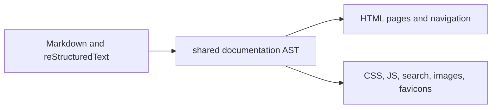

# Documentation action

> **RFC-5100 · Implemented interface**
>
> Action identifier: `evin/docs@v1`

`evin/docs@v1` compiles a documentation tree into a multi-page static web site
with navigation, search, SEO discovery files, syntax highlighting, local-image
publishing, formal references, rich Markdown components, and an optional
live-reloading preview server. Tooling catalog generation belongs to
[`evin/catalog@v1`](/reference/actions/catalog-action).



See [Build a documentation site](/book/delivery/build-a-documentation-site) for a guided setup.
This page defines the implemented action contract and its edge cases.

## Configuration

> [!IMPORTANT]
> *As part of EVIN architecture, any unknown fields are rejected. That's by design and cannot be disabled.*

### Target and source fields

| `with` field | Type | Default | Implemented contract |
| --- | --- | --- | --- |
| `site_url` | URL | required | Absolute HTTP(S) canonical base URL with a host and no query or fragment. A missing trailing slash is normalized. |
| `mode` | `build` or `serve` | `build` | For web output, either finish after generation or start the preview server and source watcher. |
| `title` | string | none | Site-wide shell and manifest title. If absent, the implementation falls back to `Documentation`; page-title inference does not populate this field. |
| `language` | string | `en` | Default BCP-47-like language identifier for web pages. |
| `source_dir` | path | `docs` | Source root. Relative paths are joined to the workspace root, not the task `cwd`. Absolute paths are accepted. |
| `include` | string list | `[]` | Optional file, directory, route-like probe, or glob selectors below `source_dir`. Empty means recursive discovery. |
| `exclude` | string list | `[]` | Glob filters matched against paths relative to `source_dir`. |
| `extract_frontmatter` | boolean | `true` | Enables YAML frontmatter extraction for Markdown. reStructuredText metadata parsing is not gated by this flag. |
| `out` | path | `dist/docs` | Web output directory. Relative paths are joined to the workspace root. Absolute paths are accepted. |

The source resolver recognizes `.md`, `.markdown`, and `.rst` files. Explicit
includes are deduplicated and the final source list is sorted by relative path.
An unreadable source is reported and skipped; failures that leave the web target
without a valid root start page fail during start-page transformation.

### Web publishing fields

| `with` field | Type | Default | Implemented contract |
| --- | --- | --- | --- |
| `asset_dir` | relative path | `assets` | Non-empty directory below `source_dir`, without `..`; supplies root-relative local images such as `/assets/logo.png`. |
| `bundle` | `separated` or `single-file` | `separated` | `single-file` inlines page CSS, JS, icon sprite, and search data. Other values are rejected during configuration parsing. |
| `minify` | boolean or null | mode-dependent | `true` by default in `build`, `false` in `serve`; controls CSS compilation style and JavaScript minification. |
| `validate_links` | boolean | `true` | Enables link, anchor, and media auditing. Math and Svgbob checks still run when disabled. |
| `strict_filenames` | boolean | `false` | Enforces the ordered public filename contract described below. |
| `reference_prefix` | string | `REF` | Trimmed, uppercased prefix for formal references; must contain only ASCII letters and digits. |
| `port` | integer | `3000` | First localhost port attempted in serve mode. The server tries up to 50 successive ports. |
| `host` | boolean | `false` | In serve mode, bind `0.0.0.0` instead of loopback so other devices on the network can reach the preview. |
| `theme_color` | string | none | PWA theme color; generated manifest fallback is `#1f1f1f`. |
| `background_color` | string | none | PWA manifest background color; fallback is `#ffffff`. |
| `topbar` | mapping or `false` | unset | Action-level announcement fallback used only when root metadata does not provide a setting. |
| `presentation` | mapping | unset | Action-level `{ variant: ... }` fallback used by `variant: inherit` surfaces. |
### Branding and layout fields

| `with` field | Effective default | Purpose |
| --- | --- | --- |
| `theme` | `matter` | Theme identifier. Missing embedded theme resources fall back to Matter resources. |
| `theme_overrides` | `{}` | CSS custom-property map appended in the final `@layer overrides`. |
| `extensions_dir` | `.evin/actions/docs` | Root for conventional logo, favicon, icons, and layouts. |
| `logo` | none | Explicit SVG file path relative to workspace root or absolute. |
| `favicon` | none | Explicit favicon file; bytes are published using its extension and MIME mapping. |
| `icon_dir` | none | Explicit directory containing SVG icons for the generated sprite. |
| `layout_dir` | none | Explicit directory containing shell, theme entry point, app script, and component overrides. |

### Minimal web tasks

```flow
tasks:
  docs-build:
    stage: Docs
    steps:
      - uses: evin/docs@v1
        with:
          site_url: https://docs.example.com/
          title: Example Project
          source_dir: docs
          out: dist/docs
          strict_filenames: true

  docs-serve:
    stage: Docs
    steps:
      - uses: evin/docs@v1
        with:
          site_url: https://docs.example.com/
          title: Example Project
          mode: serve
          host: true
```

## Web execution and emitted files

Web compilation performs this sequence:

````steps
1. **Discover and parse sources** [done]
   Compile Markdown and reStructuredText into one AST, prepare formal references, and optionally enforce strict filenames.
2. **Build publishing indexes** [done]
   Create route, source, anchor, navigation, search, SEO, and local-image catalogs.
3. **Compile rich content** [active]
   Transform the start page, audit content, highlight code, and render diagrams and MathML. Fences labeled `tape` remain static and never execute.
4. **Resolve the presentation** [upcoming]
   Select branding and layout resources, compile used component CSS and JS, and apply semantic token overrides.
5. **Write and optionally serve** [upcoming]
   Publish pages and assets, prune stale generated routes/media, then start live preview when requested.
````

### Separated bundle

The normal `separated` branch emits:

- one `index.html` per route, with the root at `index.html` and other routes at
  `<slug>/index.html`;
- `assets/theme.css`, `assets/app.js`, and `assets/icons.svg`;
- binary `assets/search-catalog.bin` and `assets/search-index.bin` (plus optional diagnostic `search.json`);
- favicon and `site.webmanifest` files below `assets/favicons/`;
- converted or copied local images below `assets/media/`;
- build-mode `robots.txt` and one sitemap or sitemap index.

Removed route `index.html` files and stale generated media are pruned on a
subsequent build.

### Single-file bundle

`bundle: single-file` embeds the processed stylesheet, application/component
scripts, and base64 search catalog into every generated page. It omits the separate theme, app, search, and font files.

> [!NOTE]
> “Single-file” applies to the page's runtime UI bundle. Favicon/manifest,
> discovery files, and referenced local media are still emitted separately, so
> a page that uses them is not a completely standalone artifact.

### Serve mode

Serve mode first writes a normal web build, then binds `127.0.0.1` beginning at
`port`. Set `with.host: true` to bind `0.0.0.0` for network access instead, or
use this action's declared one-off invocation override: `evin run docs:serve --
--host`. EVIN validates and routes that flag only to `evin/docs@v1`. It polls
the selected documentation sources and the complete configured asset directory
every 500 ms. A successful rebuild sends a server-sent reload event; a failed
rebuild leaves the previously written preview available.

The internal watcher does not fingerprint layout/branding extension files.
Use the task-level `watch` contract when changes outside the source and asset
trees must restart the full pipeline.

The server may bind a fallback port through `port + 50`. Both `server_url` and
the daemon status report the actual bound host and port.

## Outputs and dry-run behavior

| Mode | Outputs after success |
| --- | --- |
| `mode: build` | Absolute `output_dir`; string `page_count` |
| `mode: serve` | `output_dir`, `page_count`, and actual-bound `server_url` once normal execution reaches server startup |

`page_count` is the number of parsed documentation pages.

> [!WARNING]
> The documentation action does not virtualize its file writer. Under global
> `--dry-run`, the action still creates or updates its configured web output.
> For `mode: serve`, server startup is suppressed; the action
> marks that server plan unverified and does not publish `server_url`.

## Source routes and navigation order

Outside strict mode, a filename may omit ordering metadata. A leading numeric
segment followed by a dot is source-only navigation order:

| Source | Route |
| --- | --- |
| `index.md` | `/` |
| `guide.md` | `/guide` |
| `book/00.index.md` | `/book` |
| `book/10.getting-started.md` | `/book/getting-started` |
| `book/README.md` | `/book` |

Routes are checked for collisions during site preparation. Navigation uses
numeric order when present, then formal-reference number or title/slug ordering.

### Strict filename contract

With `strict_filenames: true`:

- the root start page must currently be exactly `index.md`;
- all other pages must live in a section and use `.md` or `.rst`;
- page names must match
  `<order>.<lowercase-kebab-slug>[.<reference-digits>]`;
- section indexes must be exactly `00.index.md` or `00.index.rst`;
- order zero is reserved for section indexes and numeric order must be unique
  within a section;
- formal-reference digits must start from `1`–`9`, contain at least four
  digits, and match the compiled reference ID;
- section directory segments must resolve to lowercase kebab-case names.

The non-strict source resolver can read a root `index.rst` and `.markdown`
files; the stricter filename validator intentionally narrows those cases.

## Formal references

Formal references are detected independently of strict mode from a four-or-more
digit number separated in the source stem by `-`, `_`, or the final `.`. In the
strict public convention, use a suffix:

```text
reference/20.workspace-configuration.4500.md
```

This publishes the descriptive route `/reference/workspace-configuration` and
the case-insensitive alias `REF-4500`. Reference metadata may declare:

```flow
depends_on: [REF-1000, REF-3010]
```

`depends_on` is allowed only on a formal reference. Duplicate numbers, unknown
dependencies, duplicate dependencies, self-dependencies, cycles, and route
collisions fail compilation. References render both prerequisites and reverse
“referenced by” relationships.

## Markdown authoring components

The Markdown parser enables tables, ordinary lists, task lists, headings,
links, inline images, horizontal rules, fenced code, math, and the project
extensions below. Code blocks use Syntect highlighting, with a dedicated ESH
highlighter; unknown languages remain escaped plain code. Matter adds copy and
download controls. Add an optional quoted title after the language; it is
displayed beside the language label and preserved by Markdown rendering.

````markdown "Titled code fence syntax"
```rust "Configuration loader"
fn load() -> Config {
    Config::default()
}
```
````

The equivalent reStructuredText form uses `:title:` on a `code-block` or
`code` directive.

### Tables, tasks, definitions, fields, and options

```markdown
| Field | Value |
| --- | --- |
| Status | Ready |

- [x] Parse sources
- [ ] Publish site

timeout : duration : required
    Maximum evaluation time.

:Action: `evin/docs@v1`
:Output: `dist/docs/`

--color=WHEN  Select color behavior.
```

Definition-list headers use `term : classifier` followed by indented body text.
Field-list lines use `:name: value`. Option-list lines begin directly with a
flag and separate their description with two spaces.

### Callouts

GitHub-style blockquote markers render semantic callouts. Recognized kinds are
`NOTE`, `TIP`, `IMPORTANT`, `WARNING`, `CAUTION`, `DANGER`, `HINT`,
`ATTENTION`, `ERROR`, and `SEEALSO`.

```markdown
> [!WARNING]
> A fence labeled `tape` is displayed as code. It never runs during the build.
```

An ordinary Markdown blockquote is represented as a `quote` callout.
`SPOTLIGHT` and `FEATURE` are start-page-only presentation contracts described
below.

### Stepper lists

Use a `steps` or `stepper` fence. Four backticks allow nested three-backtick
code blocks. `::: steps` / `:::` is preprocessed to the same container. An
indented continuation directly below a step title becomes its description and
supports the same inline Markdown as an ordinary paragraph.

`````markdown
````steps
1. **Configure** [done]
   Add the action to a task.
2. **Preview** [active]
   ```sh
   evin run docs-serve
   ```
3. **Publish** [upcoming]
````
`````

Recognized statuses are `done`, `active`, `in-progress`, `upcoming`, plus the
aliases `completed` → `done` and `current` → `active`.

### Math

Inline `$...$`, display `$$...$$`, and fenced `math` expressions are converted
to MathML. Invalid expressions produce audit warnings and render an escaped
fallback instead of failing the build.

### Diagrams

| Fence | Implemented rendering |
| --- | --- |
| `svgbob "Optional title"` | Converted to inline SVG at build time; basic box-width and quote-parity issues are warnings |
| `mermaid "Optional title"` | Strictly parsed and rendered by Merman 0.7.0 at build time into inline light and dark SVG variants |
| `pikchr "Optional title"` | Parsed as a diagram node but currently rendered as escaped Pikchr source in a `<pre>` block |

```svgbob "Source to site"
 +---------+      +----------+      +-------------+
 | source  | ---> | compiler | ---> | web or JSON |
 +---------+      +----------+      +-------------+
```

> [!IMPORTANT]
> Mermaid is compiled entirely offline during every web build, including when
> `validate_links` is disabled. Merman targets Mermaid 11.15 compatibility and
> produces separate light and dark inline SVGs. Invalid syntax, unsupported
> diagram families, missing diagrams, and either theme's rendering failure stop
> the build with `issue-docs-mermaid-failed`; browsers need no Mermaid runtime or
> network access. Catalog annotations remain source-only and are not rendered.

### Raw HTML and video

Unrecognized raw HTML is preserved as raw output. A narrowly recognized
`<video ...></video>` form becomes typed media only when it has `controls` and
uses supported `src`, `poster`, and `aria-label` attributes. Treat documentation
sources and custom layouts as trusted input.

## Static code fences

Fences labeled `tape` render as static code and do not execute commands. Use an ordinary language fence for samples that need syntax highlighting.

## Start-page contract

The web target requires exactly one root `index.md` or `index.rst` route. Its
top-level structure is stricter than ordinary pages:

1. one non-empty H1;
2. one non-empty lead paragraph;
3. at least one H2 card section;
4. optional Features and one optional Spotlight between the lead and sections;
5. an optional final H2 named `Footer`.

A card section may contain paragraphs, then at most one registered local/HTTPS
image or HTTPS video, then an unordered link list. Internal card routes must
exist in the selected site. The footer accepts an optional description followed
by H3 columns of internal, HTTPS, or `mailto:` links.

### Feature surface

`FEATURE` may appear multiple times only on the root page. It must contain one
H2, one description paragraph, an unordered list of one or two links, and one
final aside: image, video, code block, Mermaid, or Svgbob.

```markdown
> [!FEATURE]
>
> ## Observe a real workflow
>
> Keep the proof next to the explanation.
>
> - [Read the guide](/book/delivery/build-a-documentation-site)
>
> ```esh
> echo "ready"
> ```
```

### Spotlight surface

Only one `SPOTLIGHT` is accepted. Its marker carries a variant and optional
badge; its body is exactly an H2 (the parser also accepts H1), description
paragraph, and single CTA-link paragraph.

The variant may be `inherit`; that value is replaced by the root or
action-level `presentation.variant` and fails when neither fallback exists. An
omitted Spotlight variant also deserializes as `inherit`, although the Markdown
marker syntax normally supplies it explicitly.

```markdown
> [!SPOTLIGHT] holo | Canary
>
> ## Ship knowledge with the code.
>
> Build a searchable reference from reviewed source.
>
> [Read the guide](/book/delivery/build-a-documentation-site)
```

### Topbar and presentation metadata

Root frontmatter takes precedence over action-level `topbar`, including
`topbar: false`. A topbar mapping has:

| Field | Requirement |
| --- | --- |
| `variant` | Required; Matter variant or `inherit` when a presentation fallback exists |
| `message` | Required non-empty string |
| `id` | Optional stable ASCII letters/digits/`_`/`-`; required when dismissible |
| `badge` | Optional non-empty string |
| `action.label`, `action.href` | Optional pair; href must be an internal route, absolute HTTPS URL, or `mailto:` link |
| `dismissible` | Default `false`; dismissal is stored by ID |

Root/action `presentation` contains one required `variant`. Matter accepts:

| Variants |
| --- |
| `deepspace`, `collider`, `industrial`, `genome`, `blueprint`, `crt`, `aurora`, `cyber`, `prismatic`, `brutalist`, `holo`, `geo`, `luxury` |

Custom themes accept any non-empty lowercase kebab-case variant. Matter compiles
only the presentation variants actually selected by a topbar or Spotlight.

Root `search_prompts` must be a non-empty list of non-empty strings; its default
is `Search`.

## Local media pipeline

Markdown local images must use a root-relative URL below `asset_dir`, for
example `/assets/architecture.png`. Only referenced files are processed.

| Source extension | Published result |
| --- | --- |
| `.png`, `.jpg`, `.jpeg` | Decoded and encoded as AVIF under `assets/media/` |
| `.avif` | Copied under `assets/media/` |
| `.svg` | Copied under `assets/media/` |

The asset directory must resolve inside `source_dir`. Missing files, traversal,
unsupported extensions, query/fragment suffixes, decode failures, and output
collisions fail the build. Rendered URLs are rewritten relative to each page.

Other image URLs must be absolute HTTPS URLs to pass the media audit. Video
sources and posters are audited as HTTPS-only; local video publishing is not
implemented.

## SEO and search

Markdown title and description metadata fall back to the first heading and
first paragraph when frontmatter does not supply them. Useful page metadata is:

| Key | Effect |
| --- | --- |
| `title`, `description` | Navigation labels, document metadata, search text, and SEO quality analysis |
| `badge` | Eyebrow above a page title |
| `canonical` | Absolute HTTP(S) canonical URL; an on-site override must identify a generated default route |
| `robots` | `index` or `noindex` |
| `language` | Per-page language override |
| `updated` | `YYYY-MM-DD` or RFC 3339 value used as sitemap `lastmod` |

Build mode emits canonical/open-graph metadata, indexable self-canonical routes
in sitemap files, and a `robots.txt` pointing at the sitemap. Serve mode emits
`robots.txt` with `Disallow: /` and no sitemap.

Missing/short/long descriptions, titles over 60 characters, duplicate titles,
and duplicate descriptions are counted as SEO quality warnings, not failures.
Invalid canonical, robots, language, or updated values fail web rendering.

Search indexes headings, prose, routes, and root search prompts. Separated mode
publishes binary and JSON representations; single-file mode embeds the binary
catalog in each page.

## Branding and resource precedence

Resolution differs by resource:

| Resource | Precedence |
| --- | --- |
| Logo | explicit `logo` → `<extensions_dir>/logo.svg` → `<extensions_dir>/icons/logo.svg` → neutral `🕮` with warning |
| Favicon | explicit `favicon` → exactly one conventional `favicon.svg`, `.png`, or `.ico` in `extensions_dir` → neutral generated SVG |
| Icons | explicit `icon_dir` → `<extensions_dir>/icons` → built-in icons only |
| Layout | explicit `layout_dir` → `<extensions_dir>/layouts/<theme>` → legacy `.evin/layouts/<theme>` with warning → embedded theme/Matter |

Multiple conventional favicon candidates are an error. Explicit paths must
exist with the required file/directory type.

```text
.evin/actions/docs/
├── logo.svg
├── favicon.svg
├── icons/
└── layouts/
    └── matter/
        ├── shell.html
        ├── theme.scss
        ├── app.js
        └── templates/
            ├── callout.evin
            ├── code_block.html
            └── code_block.scss
```

Within a selected layout, `shell.html`, `theme.scss` or `theme.css`, and
`app.js` or `search.js` override their embedded counterparts. Component files
under `templates/` override by filename stem after embedded Matter and
theme-specific components are loaded.

## Custom components and shells

Components may use an `.evin` single-file component or a same-stem
`.html`/`.scss`/`.js` triad. An `.evin` file supports `<template>`, optional
`<style>` and `<script>`, and `<style scoped>`, which injects a
`data-c-<component>` attribute into the first root element and wraps styles in
native `@scope`.

Template syntax is:

| Form | Implemented behavior |
| --- | --- |
| `{{name}}` | Insert the provided value |
| `{{{name}}}` | Insert the provided value |
| `{{#if name}}...{{/if}}` | Render when value is present and not empty, `0`, or `false` |

> [!WARNING]
> Despite the two brace forms, the current template evaluator inserts both
> values without escaping. Built-in renderer call sites pre-escape values that
> require it. Custom component authors must not assume `{{name}}` is an HTML
> escaping boundary.

Component SCSS and JavaScript are collected only for component names used by
the rendered site. A complete custom shell can use typed slots such as
`<site-title>`, `<page-meta>`, `<favicons>`, `<icons-sprite>`, `<css>`,
`<sidebar-nav>`, `<breadcrumbs>`, `<content>`, `<toc>`, `<pagination>`,
`<search-data>`, `<search-js>`, `<component-js>`, and `<live-reload>`. When a
topbar is enabled, the shell must contain exactly one `<topbar>` slot.

## Semantic theme overrides

Keys have leading `--` removed and underscores normalized to hyphens. Unknown
keys become CSS custom properties directly, so
`brand_accent: red` emits `--brand-accent: red`.

| Public alias | Emitted property |
| --- | --- |
| `primary`, `ui-primary` | `--ui-color-primary` |
| `on-primary`, `ui-on-primary` | `--ui-color-on-primary` |
| `surface`, `ui-surface` | `--ui-color-surface` |
| `ui-bg`, `ui-on-bg` | `--ui-color-background`, `--ui-color-on-background` |
| `ui-surface-variant`, `ui-surface-container[-lowest|-low|-high|-highest]` | matching `--ui-color-*` |
| `ui-on-surface`, `ui-on-surface-variant`, `ui-outline`, `ui-outline-variant` | matching `--ui-color-*` |
| `ui-hover`, `ui-code-bg`, `ui-code-text`, `ui-link`, `ui-link-hover` | state, code, and link color properties |
| `ui-banner-bg`, `ui-banner-text`, `ui-banner-badge-bg`, `ui-banner-badge-text`, `ui-banner-border` | banner color properties |
| `font-sans`, `font-mono` | `--ui-typescale-font-sans`, `--ui-typescale-font-monospace` |
| `ui-radius-xs`, `sm`, `md`, `lg`, `xl`, `full` forms | Matter corner-scale properties |
| `ease`, `duration` | standard motion easing and medium duration |
| `sidebar-width`, `content-max-width`, `header-h` | shell layout properties |
| `ui-space-<n>` | `--ui-ref-space-<n>` for any supplied suffix |
| `spacing-paragraph-bottom`, `spacing-heading-top`, `spacing-heading-bottom`, `spacing-section-gap`, `spacing-card-padding`, `spacing-inline-gap` | documentation rhythm properties |

Overrides are sorted and appended in the final `@layer overrides`, after theme
and used-component CSS.

## Validation, audits, and fallbacks

The action has both hard compilation checks and non-fatal audits. “Validated”
does not mean every warning stops publishing.

| Condition | Implemented effect |
| --- | --- |
| Invalid config, strict filename, route collision, formal-reference graph, start-page structure, SEO declaration, local image, or primary output I/O | Fails the action |
| Broken formal alias or heading anchor | Audit warning; output is still written |
| Missing ordinary internal route | Preserved without a warning so filtered builds may link outside their selected corpus |
| Invalid non-local media URL | Audit warning |
| Invalid MathML conversion or suspicious Svgbob box/quotes | Audit warning and rendering fallback/output |
| Mermaid parse, detection, unsupported-family, or light/dark render failure | Hard `issue-docs-mermaid-failed` error with the source path and diagram title or position; no output is published |
| Theme SCSS compilation failure | Warning, then raw theme source is used as a CSS fallback |
| Missing project logo | Warning and neutral glyph |
| Some auxiliary asset writes | Counted in debug output statistics rather than propagated as a hard error |

When `validate_links: false`, link and media traversal is skipped, but math and
Svgbob audit warnings are still produced.

## Tooling catalogs

Use [`evin/catalog@v1`](/reference/actions/catalog-action) to compile symbol and keyword records for editor and terminal tooling. The catalog action owns the `lsp`, `symbol`, and `keyword` source annotations; they are separate from web-site rendering and configuration.

````lsp
target: [action, evin/docs@v1]
language: flow
title: Documentation action
synopsis: "uses: evin/docs@v1"
summary: Compile, serve, and validate static project documentation.
category: action
---
Configure this action with a `with:` mapping.
````
