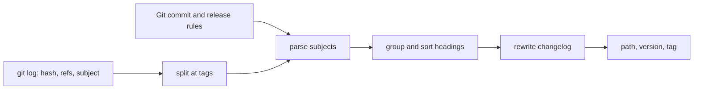

# Changelog action

> **RFC-5120 · Implemented interface**
>
> Action identifier: `evin/changelog@v1`

`evin/changelog@v1` reads the complete decorated Git history from newest to
oldest, starts a release block at each discovered tag, parses recognized commit
subjects, groups them into named sections, and rewrites a Markdown file.



The action generates release notes from commit subjects. It does not read an
existing changelog, preserve hand-written release blocks, query a hosting
provider, or generate compare links and release dates.

## Configuration

Unknown fields are rejected.

| `with` field | Type | Default | Implemented contract |
| --- | --- | --- | --- |
| `path` | string | `CHANGELOG.md` | Non-empty output path. Relative paths use the task `cwd` and must remain inside the workspace. |
| `include_unreleased` | boolean | `true` | Include commits newer than the first tagged commit as a pending block. |
| `preamble` | string | See below | Markdown copied verbatim before generated blocks. |
| `show_hashes` | boolean | `true` | Append the abbreviated Git hash from `%h` in parentheses. |
| `show_scopes` | boolean | `true` | Prefix scoped changes with `**scope:**`. |
| `unreleased_heading` | string | `Unreleased` | Non-empty pending-block heading when `version` is absent. |
| `sections` | string map | `{}` | Per-commit-type heading overrides; a case-insensitive value of `none` omits that type. Keys must be non-empty. |
| `version` | string | none | Optional pipeline template used to rename the pending block. Required by validation when `include_unreleased: false`. |
| `notes_path` | string | none | Optional non-empty output path for only the pending block's body, without the changelog preamble or heading. Written with the same containment rules as `path`; parent directories are created. |
| `label` | string | none | Optional template appended after the generated pending heading (renamed by `version`, when set) as `— <label>`. It does not alter the version or tag. |

The exact default preamble is:

```markdown
# Changelog
All notable changes to this project will be documented in this file.

```

All strings pass through the task template context during runtime loading.
`notes_path` is written only when the pending block exists, and is not written
in dry runs. When written, the action publishes a `notes_path` output with the
same value, so a later task can use the file as a review request or release body.
`version` and `label` also receive explicit template-syntax validation.

```flow
values:
  release_version: "1.2.0"

tasks:
  changelog:
    stage: Release
    steps:
      - uses: evin/changelog@v1
        with:
          path: CHANGELOG.md
          version: "${release_version}"
          label: "Preview"
          show_hashes: false
          sections:
            feat: Added
            fix: Fixed
            docs: Documentation
            chore: none
```

The label is opt-in and is copied as configured. It has no sequence rules and
does not participate in version or tag calculation. A reusable value can be
defined in namespace `values` and passed only to actions and destinations that
should display it.

## How history becomes release blocks

The Git provider runs a decorated log and supplies commits in newest-first
order. For each commit, the action performs these operations:

1. If the decoration contains a `tag: <name>` entry, close the current block
   and begin a block named exactly after that tag.
2. If `releases.commit_message` can be compiled as a Git-rules template and
   matches the subject, skip the release commit itself.
3. Parse the subject with `commits.message_format`. If that fails, try the
   built-in Conventional Commit header
   `type(scope)!: subject` / `type: subject` parser.
4. Add recognized commits to the current block. Unrecognized subjects are
   omitted.

Tags do not need to contain SemVer. A tag named `preview-august` creates a
historical `## [preview-august]` block. When one commit has multiple tag
decorations, only the first `tag:` entry exposed in the refs string is used.

> [!NOTE]
> A tag boundary is processed before the tagged commit subject. A release
> commit is normally kept out of that historical block by the configured
> `releases.commit_message` skip pattern.

## Section selection and ordering

For every parsed commit, the section is selected in this order:

| Priority | Source | Result |
| --- | --- | --- |
| 1 | `with.sections[commit_type]` | Custom heading, or omission when the value equals `none` ignoring case |
| 2 | `releases.change_types.<type>.changelog_section` | Git-rules heading |
| 3 | Git-rules fallback | `Features` for `feat`, `Bug Fixes` for `fix`, otherwise `Other Changes` |

Section headings are sorted alphabetically inside each release block. Commit
items retain newest-first history order within their section. When ticket
linking is configured under `releases.changelog.ticket_linking`, matching
ticket text in the subject is converted to Markdown links.

Given these commits:

```text
feat(cli): add sequential execution override
fix(ui): reclaim the terminal after cancellation
docs: explain environment selection
chore: refresh lockfile
```

the configuration above renders the pending block as:

```markdown
## [v1.2.0]

### Added

- **cli:** add sequential execution override

### Documentation

- explain environment selection

### Fixed

- **ui:** reclaim the terminal after cancellation
```

`chore` is absent because of the `none` override. With `show_hashes: true`,
each list item ends in an abbreviated hash such as `(8f13a9c)`.

## Pending versions and tag formatting

When `include_unreleased: true`, commits above the newest tag begin in an
internal `Unreleased` block. Its displayed name is selected as follows:

| Configuration | Displayed heading |
| --- | --- |
| no `version` | `unreleased_heading` |
| `version: 1.2.0` | First `tags.name_format` rendered with `version = 1.2.0` |
| `version: v1.2.0` | Leading `v` characters are removed before applying the tag format |

With the default `tags.name_format: "v{version}"`, both version examples
display `v1.2.0`.

An empty pending block is not rendered. Historical tagged blocks with commits
are still rendered after it.

> [!IMPORTANT]
> `include_unreleased: false` ignores all commits newer than the newest tag.
> The current schema still requires `version`, but that value does not rename
> any historical block and therefore has no visible effect on the generated
> Markdown in this mode.

## Rewrite and failure behavior

The generated document is `preamble` followed only by non-empty release blocks.
The final content is trimmed to one trailing newline and written through the
action SDK filesystem, which creates missing parent directories.

The action overwrites the destination. It does not merge with existing text or
recover content below an existing preamble. Git history or configuration errors
occur before the write; a filesystem error can fail at the final write.

## Outputs

| Output | Availability | Meaning |
| --- | --- | --- |
| `path` | Every successful normal or dry-run execution | Configured output path as a string |
| `notes_path` | `notes_path` is configured, a pending block exists, and the run is normal | Configured notes path as a string |
| `tag` | At least one release block contains parsed commits | Display name of the first non-empty block |
| `version` | At least one release block contains parsed commits | That display name after removing leading `v` characters |

The first non-empty block is normally the pending block, but it can be the
newest historical tag when no pending commit was recognized. An empty history,
or history containing only unrecognized/omitted commits, publishes only `path`.

## Dry runs

A dry run still reads and groups real Git history and computes the same
conditional `version` and `tag` outputs. It reports the blocks that would be
rendered, publishes `path`, does not write the changelog, and marks the task
unverified with `changelog generation bypassed in dry-run`.

See [Git rules configuration](/reference/git-rules-configuration) for commit
formats, section definitions, tag naming, release-commit matching, and ticket
linking.

````lsp
target: [action, evin/changelog@v1]
language: flow
title: Changelog action
synopsis: "uses: evin/changelog@v1"
summary: Generate a changelog from Git history.
category: action
---
Configure changelog generation through `with:`.
````

````lsp
target: [action, evin/changelog@v1, with, notes_path]
language: flow
title: Release notes file
synopsis: "notes_path: target/release-notes.md"
summary: Write the pending section body to a separate file.
category: action-field
---
Written only when an Unreleased block exists and not in dry runs. Use it as a review request body. Publishes a `notes_path` output.
````
