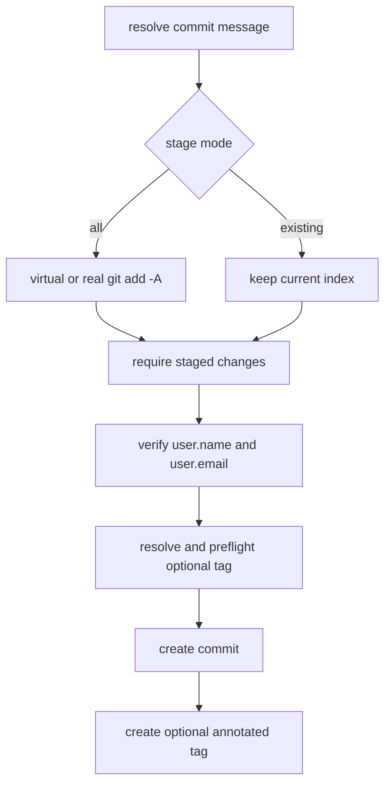

# Git release action

> **RFC-5130 · Implemented interface**
>
> Action identifier: `evin/git-release@v1`

`evin/git-release@v1` turns prepared repository changes into one local commit
and can attach one annotated tag. It does not calculate a version, edit files,
push refs, create a hosted release, or upload artifacts.



## Configuration

Unknown fields are rejected.

| `with` field | Type | Default | Implemented contract |
| --- | --- | --- | --- |
| `stage` | `all` or `existing` | `all` | `all` stages with `git add -A`; `existing` requires and uses the current index without staging other worktree changes. |
| `message` | string | Git-rules release message | Optional non-empty pipeline template used as the commit message. |
| `tag` | string | none | Optional non-empty pipeline template for a tag name. |

Both optional strings receive template-syntax validation. Runtime templates can
read values, environment variables, and outputs from prerequisite tasks.

```yaml
tasks:
  bump:
    stage: Release
    steps:
      - uses: evin/version-bumper@v1
        with:
          files: [Cargo.toml]

  release:
    stage: Release
    needs: [bump]
    steps:
      - uses: evin/git-release@v1
        with:
          stage: all
          message: "chore(release): ${bump.version}"
          tag: "${bump.tag}"
```

If `message` is absent, the action uses
`releases.commit_message` from the resolved Git rules. It fails when neither
source supplies a message.

> [!IMPORTANT]
> This action performs pipeline-template expansion (`${...}`), not Git-rules
> format rendering. A fallback message such as `chore(release): {version}` is
> committed with `{version}` unchanged because this action has no calculated
> version value. Supply `message: "... ${producer.version}"` when the version
> must be inserted.

## Choosing a staging boundary

| Mode | What enters the commit | Precondition | Main risk |
| --- | --- | --- | --- |
| `existing` | Only changes already in the Git index | At least one staged change must exist | A required release file can be omitted if it was not staged |
| `all` | Every tracked modification/deletion and every untracked file visible to `git add -A` | The worktree or index must contain a change | Unrelated worktree files can enter the release commit |

Use `existing` when an earlier command deliberately assembled a reviewable
index:

```sh
git add Cargo.toml Cargo.lock CHANGELOG.md
evin run release
```

Use `all` only when the task owns the complete worktree state. The default is
`all`, so choose `existing` explicitly when isolation is required.

## Commit and tag policy

Before mutation, the action verifies that `user.name` and `user.email` are
available from Git configuration. Commit creation passes
`authorship.policies.require_signatures` to the Git provider; when enabled, Git
is invoked with `-S`.

If `tag` is configured, the action resolves it, checks it with
`git check-ref-format`, and rejects an existing tag before it creates the
commit. After a successful commit it runs the equivalent of:

```sh
git tag -a <tag> -m <commit-message>
```

The tag is annotated but is not created with Git's signed-tag flag. The action
does not consult a remote or test whether the branch can be pushed.

## Failure and recovery boundaries

````steps
1. **Configuration and staged-change checks** [done]
   Fail without changing history when the message is unavailable or the selected staging mode produces no staged change.
2. **Identity and tag preflight** [done]
   Verify identity, validate the optional tag name, and reject an existing tag before committing.
3. **Commit** [active]
   Create one commit, optionally signed according to Git rules.
4. **Annotated tag** [upcoming]
   Create the tag with the same message used for the commit.
````

The staging phase itself is a mutation in normal execution. A later identity or
tag-preflight error can therefore leave files staged even though no commit was
created.

Commit and tag creation are separate Git operations. If the commit succeeds but
tagging fails, the commit remains at `HEAD`. The action reports the commit ID,
intended tag, and Git error in a recovery diagnostic; it does not reset or amend
history automatically.

> [!WARNING]
> The action provides no rollback for staging or a successful commit. Resolve a
> reported tag failure explicitly after inspecting `HEAD` and the local tags.

## Dry runs

The Git provider virtualizes `git add`, commit, and tag creation. A dry run still:

- resolves the message and optional tag templates;
- checks for staged or worktree changes according to `stage`;
- verifies Git identity;
- validates the tag name and checks the real repository for an existing tag;
- honors virtual file changes produced by earlier dry-run steps when
  `stage: all` is used.

No real commit or tag is created. The action itself does not mark this plan
unverified. If a tag is configured, the virtual tag operation succeeds and the
action publishes the resolved `tag` output.

## Outputs

| Output | Availability | Meaning |
| --- | --- | --- |
| `tag` | A configured tag reaches successful normal or virtual tag creation | Resolved local tag name |

There is no commit-SHA output and no output when `tag` is omitted. A dependent
task that needs the commit ID can run `git rev-parse HEAD` after this task.

Use [`evin/version-bumper@v1`](/reference/actions/version-bumper-action) when
one action should discover the next semantic version, update files, and
optionally perform the commit and tag. Use this action when those preparations
are deliberately separate.
