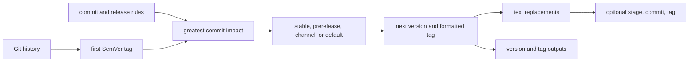

# Version bumper action

> **RFC-5140 · Implemented interface**
>
> Action identifier: `evin/version-bumper@v1`

`evin/version-bumper@v1` scans decorated Git history for the newest
SemVer-compatible tag, maps newer parsed commits to release impacts, computes a
version, edits configured files, and can create one release commit and annotated
tag.



The action is intentionally textual. It is not a package-manager client, does
not update dependency locks by itself, and does not publish a release.

## Configuration

Unknown fields are rejected at the root, custom-file, and `git` object levels.

| `with` field | Type | Default | Implemented contract |
| --- | --- | --- | --- |
| `initial_version` | SemVer string | `0.1.0` | Version selected directly when no SemVer tag is found. |
| `files` | list | `[]` | Automatic manifest path strings or custom `{ path, match, write }` objects. |
| `stable` | boolean | `false` | Remove the current prerelease suffix. Conflicts with `prerelease` and `channel`. |
| `prerelease` | string | none | Valid prerelease prefix used when branching from a stable version. Conflicts with `stable` and `channel`. |
| `channel` | string | none | Key under `releases.prerelease.channels`. Conflicts with `stable` and `prerelease`. |
| `require_change` | boolean | `false` | Fail before writing files when qualifying commits do not calculate a new version. |
| `git` | object | defaults below | Controls optional commit, tag, message, and additional staged paths. |

### Git object

| `git` field | Type | Default | Implemented contract |
| --- | --- | --- | --- |
| `commit` | boolean | `false` | Stage version files and `include`, then create a commit when there is something configured to stage. |
| `tag` | boolean | `false` | Create the calculated annotated tag after the commit; requires `commit: true`. |
| `message` | string | Git-rules release message | Optional non-empty template. The only action-local placeholder is `${version}`. |
| `include` | list of strings | `[]` | Additional non-empty paths staged with modified version files. |

`git.message`, custom `match`, and custom `write` reject unsupported `${...}`
placeholders during configuration validation. The generic task loader runs
first at execution, but the public local contracts are still:

| Location | Allowed local placeholder |
| --- | --- |
| `git.message` | `${version}` |
| custom `match` | `${previous_version}` |
| custom `write` | `${version}` |

## Complete example

```yaml
tasks:
  bump:
    stage: Release
    steps:
      - uses: evin/version-bumper@v1
        with:
          initial_version: 0.1.0
          files:
            - Cargo.toml
            - package.json
            - path: .evin/workspace.yaml
              match: 'version:\s*"${previous_version}"'
              write: 'version: "${version}"'
          git:
            commit: true
            tag: true
            message: "chore(release): ${version}"
            include: [Cargo.lock]
```

This commits only files actually changed by the action plus `Cargo.lock`. It
does not stage every worktree change.

## Release boundary and impact discovery

The action asks Git for the complete history in newest-first order. It stops at
the first commit whose decoration exposes a tag that becomes valid SemVer after
leading `v` characters are removed. Tags below that boundary are not examined.

Commits above the boundary are parsed only with the configured
`commits.message_format`. Unlike the changelog action, version bumper has no
built-in Conventional Commit parser fallback. Parsed commit types are mapped by
`releases.change_types`; breaking changes can take the configured major impact.
The greatest impact wins.

| History condition | Calculation entry point |
| --- | --- |
| No SemVer tag exists | Select `initial_version` exactly; commit impacts and release mode do not alter it |
| SemVer tag exists, but every parsed impact is `none` or no commit parses | Return the previous version immediately; do not inspect files or mutate Git |
| SemVer tag exists and at least one impact exists | Apply the selected release mode to the previous version |

When there is no prior tag, custom `${previous_version}` matching uses `0.0.0`,
not `initial_version`.

A configured named channel is still looked up and hydrated before this
no-tag branch selects `initial_version`. Consequently, a missing channel or an
unresolvable channel variable can fail the action even though the hydrated
channel does not alter that initial version.

> [!IMPORTANT]
> `stable: true` does not force a release by itself. A non-`none` impact must
> exist above a previous tag before stable promotion runs. With no impact, the
> action returns the unchanged version before evaluating the release mode.

## Version transition rules

Let `N` be `0` by default or `1` when
`releases.prerelease.start_at_one: true`.

| Previous state and mode | Implemented result |
| --- | --- |
| Stable version, default mode | Bump major/minor/patch according to greatest impact |
| Stable version, `prerelease: rc` | Bump the base according to impact, then append `rc.1` |
| Prerelease version, default mode | Increment its final numeric identifier; if none exists, append `.1`; do not bump the base |
| Prerelease version, `prerelease: <value>` | Same as default prerelease advancement; the supplied prefix is not substituted on this branch |
| Prerelease version, `stable: true` | Remove the prerelease suffix without bumping the base |
| Stable version, `stable: true` | Produces the same base version; the later existing-tag check normally rejects its already-present tag |
| Stable version, `channel: name` | Bump the base, then append the hydrated channel prefix and `.N` |
| Same-channel prerelease | Increment a final numeric suffix; otherwise reset the suffix to `N` |
| Different-channel prerelease | Keep the base version and replace the prerelease with the selected prefix plus `.N` |

The literal `prerelease` option always starts new stable-to-prerelease branches
at `.1`; it does not consult `start_at_one`.

### Named channels

Named channels come from Git rules:

```yaml
releases:
  prerelease:
    start_at_one: false
    channels:
      canary: "canary.{n}"
      branch: "{git.branch}.{n}"
```

Supported channel variables are:

| Variable | Resolution |
| --- | --- |
| `{n}` | Preserved for the version counter |
| `{workspace.name}` | Resolved workspace name; missing name is an error |
| `{git.branch}` | Current branch normalized character-by-character to lowercase alphanumeric or `-` |
| `{git.short_sha}` | Current abbreviated commit ID |
| `{date.ymd}` | Local date in `YYYYMMDD` form |
| `{env.NAME}` | Process environment variable; missing or empty is an error |

Unknown variables fail. The version calculator uses the text before `{n}` as
the channel prefix and trims trailing dots. Place `{n}` at the end of the
template; text after it is not incorporated into the calculated prerelease.
The hydrated prerelease must also be acceptable to the SemVer parser or it can
collapse to an empty prerelease in the current implementation.

## File update forms

### Automatic manifest paths

A string entry is accepted only when its basename is one of:

| Basename | Match | Replacement |
| --- | --- | --- |
| `Cargo.toml` | First line matching `version = "..."` or single quotes | Normalized `version = "<next>"` |
| `pyproject.toml` | Same TOML expression | Normalized `version = "<next>"` |
| `package.json` | First member matching `"version": "..."` or single quotes | Normalized `"version": "<next>"` |

The regex replacement changes only the first match. It does not understand TOML
tables or JSON structure, so the first textual version field may not be the
project version.

> [!WARNING]
> Automatic mode can update the wrong field in a multi-package or richly
> structured manifest. Use a custom mapping when the intended version needs a
> more specific context.

### Custom mappings

```yaml
files:
  - path: VERSION
    match: '^${previous_version}$'
    write: '${version}'
```

| Field | Contract |
| --- | --- |
| `path` | Non-empty file path read through the task filesystem |
| `match` | Non-empty Rust regular expression after `${previous_version}` is replaced with the escaped old version |
| `write` | Non-empty replacement text after `${version}` substitution |

The action uses a single regex replacement, not `replace_all`. Rust regex
replacement expansion still applies to `$name` and `$1` sequences that remain
in the final `write` value.

If the file content is unchanged after replacement, that path is not considered
modified. Missing files and read/write errors fail the action. Writes happen in
configuration order and are not rolled back if a later file or Git operation
fails.

## Tag calculation and preflight

After calculating the version, the action renders the first
`tags.name_format` with `{version}`. The default produces `v<version>`.

The real repository is checked for that tag even when `git.tag` is `false`. If
the calculated tag already exists, the action fails before file edits. Tag-name
syntax is checked with Git only when `git.tag: true`.

## Optional Git mutation

When `git.commit: true`, identity is verified before file edits. After edits:

1. Enter the Git phase only when at least one version file changed or
   `git.include` is non-empty.
2. Resolve `git.message`, or take `releases.commit_message` and render its
   `{version}` field into the local `${version}` form.
3. Stage modified version files plus every `git.include` path.
4. Require at least one staged change.
5. Commit with `-S` when Git rules require signatures.
6. If enabled, create an annotated tag with the commit message as annotation.

If no version file changed and `git.include` is empty, no commit and no tag are
created—even when both Git booleans are true. If the commit succeeds and tag
creation fails, the commit remains; the diagnostic reports its ID and intended
tag for manual recovery.

## Outputs and no-impact behavior

| Path | `version` | `tag` |
| --- | --- | --- |
| Normal calculation without a planned Git dry-run commit | Calculated SemVer | Calculated tag-format result, whether or not `git.tag` is enabled |
| No-impact early return | Previous SemVer | Previous version rendered through the tag format |
| Dry run that reaches planned `git.commit` work | Calculated SemVer | Not published on this return path |

`tag` is a calculated name; its presence does not prove that a Git tag was
requested or created.

## Dry runs

A dry run uses real Git history and real source-file content for calculation,
but does not write files or change Git history. Changed files generate update
plans.

- With `git.commit: false`, the action normally publishes both outputs and does
  not mark the task unverified.
- With `git.commit: true` and at least one planned file change or a non-empty
  `git.include`, it plans the commit and optional tag, marks the task unverified,
  publishes `version`, and returns before publishing `tag`.
- With `git.commit: true` but no changed file and an empty `git.include`, it
  skips the Git plan and publishes both calculated outputs.

See [Git rules configuration](/reference/git-rules-configuration) for commit
parsing, impact mapping, channel definitions, release messages, tag formats,
and signature policy.
