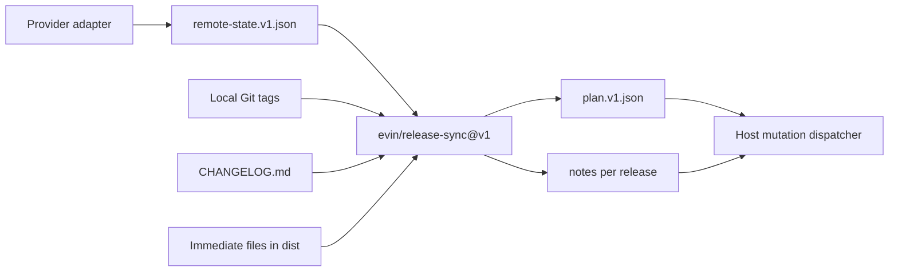

# Release sync action

> **RFC-5150 · Implemented interface**
>
> Action identifier: `evin/release-sync@v1`

`evin/release-sync@v1` is the planning half of a release-delivery workflow. It
reads a host-produced snapshot of remote releases, inspects local Git tags, extracts
matching changelog sections, scans local artifacts, and writes a JSON plan of
the mutations required to bring the remote state in line with those local
inputs.

The planner does not authenticate with a forge, fetch remote state, or execute
the generated mutations. Its Rust core depends on traits for remote-state
loading, Git inspection, notes extraction, artifact inspection, policy, and
plan output. A host integration supplies those adapters and applies the
provider-neutral plan afterward.



> [!IMPORTANT]
> The action only produces instructions. A successful `REL_INIT`, `ART_PUT`, or
> `REL_PRUNE` entry means that the operation is required; it does not mean the
> remote forge was changed.

## Configuration

Unknown `with` fields are rejected. Relative paths are joined to the workspace
root. Absolute paths are also accepted by the underlying path resolution and
therefore are not confined to `.evin/actions/release-sync`.

| `with` field | Type | Default | Implemented behavior |
| --- | --- | --- | --- |
| `tag` | string | unset | When set, reconcile only this local Git tag. An unknown local tag is an error. |
| `title` | string | annotated tag subject | Explicit title for reconciled releases. When set, it replaces the derived title for each selected local tag; it does not change the tag. |
| `state` | string | `.evin/actions/release-sync/remote-state.v1.json` | Remote-state JSON to read. The value must not be empty. |
| `plan_out` | string | `.evin/actions/release-sync/plan.v1.json` | Destination for the pretty-printed plan JSON. The value must not be empty. |
| `notes_dir` | string | `.evin/actions/release-sync/notes` | Directory for changelog slices referenced by plan actions. The value must not be empty. |
| `artifacts_dir` | string | `dist` | Directory whose immediate regular files are treated as release assets. It is not scanned recursively. |
| `changelog` | string | `CHANGELOG.md` | Changelog source used to calculate release-note bodies and hashes. A missing or unreadable file behaves like an empty changelog. |
| `dry_run` | boolean | `false` | Runs ingestion, Git inspection, artifact inspection, and reconciliation but skips every notes and plan write. Outputs are still published. |
| `prune_orphans` | boolean | `false` | Plans deletion of a remote release only when it has no matching local tag and its remote `is_draft` field is `true`. |

`tag`, `title`, `state`, `plan_out`, and `notes_dir` receive explicit non-empty
validation when provided. An empty `artifacts_dir` or `changelog` is accepted
and resolves according to normal workspace path joining.

### Minimal task

```flow
tasks:
  reconcile-releases:
    stage: Delivery
    steps:
      - uses: evin/release-sync@v1
```

With no `with` mapping, the host must have already written
`.evin/actions/release-sync/remote-state.v1.json`, and the workspace must be a Git
repository that `git tag` can inspect.

### Typical release pipeline

```flow
tasks:
  package:
    stage: Package
    steps:
      - uses: evin/archive@v1
        with:
          path: dist/evin-linux-x86_64.tar.gz
          include: [target/release/evin, LICENSE]

  changelog:
    stage: Release
    needs: [package]
    steps:
      - uses: evin/changelog@v1
        with:
          path: CHANGELOG.md

  reconcile:
    stage: Delivery
    needs: [changelog]
    steps:
      - uses: evin/release-sync@v1
        with:
          state: .evin/actions/release-sync/remote-state.v1.json
          tag: v1.4.0-canary.2
          plan_out: .evin/actions/release-sync/plan.v1.json
          notes_dir: .evin/actions/release-sync/notes
          artifacts_dir: dist
          changelog: CHANGELOG.md
```

The planner accepts any provider that emits the normalized state contract.
This repository keeps host integration outside the planner: the
`RELEASE_PROVIDER` lookup in `scripts/release/provider.esh` selects a provider
adapter implementing `snapshot`, `apply`, and `summary`. The GitHub adapter is
currently the only registered provider. A new forge can add an adapter and one
lookup entry without changing the reconciliation engine. Other projects can
implement the same contract in their own host workflow.

## Execution contract

The action performs these operations in order:

1. **Parse configuration and remote state.** The action reads `state` as JSON
   and requires protocol version `v: 1`.
2. **Collect local release inputs.** It parses the changelog, calls the local
   `git` executable to list tags, and scans immediate artifact files.
3. **Reconcile releases.** It compares local tags with matching remote
   releases, then evaluates eligible orphaned remote drafts.
4. **Write notes and the plan.** It writes required notes, then the formatted
   JSON plan unless `dry_run` is enabled.
5. **Publish outputs.** It exposes the plan path, mutation count, and
   reconciliation result to dependent tasks.

The core reconciler is synchronous and performs no network I/O. The action
adapter does perform local process and filesystem I/O: it launches `git`, reads
the configured inputs, and writes the configured outputs.

> [!WARNING]
> Writes are direct filesystem writes, not a transaction. If a later note or
> plan write fails, an earlier note file can remain on disk. Existing files at
> the same paths are overwritten, and stale note files are not removed.

## Remote-state ingestion

The input JSON represents what the host currently knows about the forge:

```json
{
  "$schema": "https://everyinit.dev/schemas/v1/release-sync-remote-state.json",
  "v": 1,
  "provider": "github",
  "repository": "owner/repository",
  "releases": [
    {
      "tag": "v1.4.0-canary.2",
      "commit": "4cf71be4a509",
      "title": "v1.4.0-canary.2",
      "is_draft": false,
      "is_prerelease": true,
      "body_sha256": "8f610c40db89b840272317335d9f4ea3d89a987e821c190ecec0baf37b1f9102",
      "published_at": "2026-08-25T14:30:00Z",
      "assets": [
        {
          "name": "evin-linux-x86_64.tar.gz",
          "size_bytes": 14280900,
          "sha256": "6a30f630de42b53f650c1910822613e462fec3207518a3b51e8d02b58671050c"
        }
      ]
    }
  ]
}
```

### Ingestion fields

| Location | Field | Required | Behavior |
| --- | --- | --- | --- |
| root | `$schema` | no | Defaults in memory to the remote-state schema URL when omitted. Its supplied value is not validated. |
| root | `v` | yes | Must equal `1`; another value fails reconciliation. |
| root | `provider` | yes | Provider identifier copied into the plan so the host dispatcher can reject plans sent to the wrong adapter. |
| root | `repository` | yes | Deserialized as a string but not otherwise interpreted or validated. |
| root | `releases` | no | Defaults to an empty list. Releases are matched to local tags by exact tag text. |
| release | `tag` | yes | Exact reconciliation key. |
| release | `commit` | no | A non-empty value differing from the local target produces `REL_RETARGET`; missing or empty values do not. |
| release | `title` | no | Compared with the local title. A missing remote title is considered different when a local title exists. |
| release | `is_draft` | no | Defaults to `false`. Also controls orphan pruning eligibility. |
| release | `is_prerelease` | no | Defaults to `false`. Compared with locally inferred channel state. |
| release | `body_sha256` | no | Compared with the SHA-256 of a matching changelog slice. Missing and empty values produce `DIFF_BODY_EMPTY`. |
| release | `published_at` | no | Preserved by deserialization but not used during reconciliation. |
| release | `assets` | no | Defaults to an empty list and is indexed by exact asset name. |
| asset | `name` | yes | Compared with the local file name. |
| asset | `size_bytes` | yes | Compared with local file length. |
| asset | `sha256` | no | Compared only when the local artifact provider also supplies a hash. |

Unknown JSON fields are accepted. The schema URL, provider identifier,
repository, commit shape, timestamp shape, hash length, and hash encoding are
not validated by the current implementation. Duplicate release tags or asset
names are not rejected; the last value inserted into the reconciliation lookup
wins.

## Local Git model

The action executes:

```text
git tag -l --format=%(refname:short)|%(*objectname)|%(objectname)|%(contents:subject)
```

Every returned tag participates; the action does not filter tags to semantic
versions or require annotated or signed tags. Annotated tags use the peeled
object ID as their target. Lightweight tags use their direct object ID. The
formatted subject becomes the local release title, with the tag itself as a
fallback. The optional `title` field overrides that derived title for every
selected local tag.

The adapter records whether a tag is annotated, but the reconciler does not
currently use that flag. It also does not verify signatures or fetch missing
tags. Failure to launch `git` or a non-zero `git tag` exit fails the action.

### Local release policy

Draft state is always inferred as `false`. Prerelease state is inferred as
follows:

1. Remove leading `v` characters and try to parse the remainder as SemVer.
2. For valid SemVer, any non-empty prerelease component means prerelease.
3. For non-SemVer tags, a case-sensitive occurrence of `-`, `rc`, `canary`,
   `beta`, or `alpha` means prerelease.

Consequently, a remote draft matching any local tag produces `REL_MUT` to set
`draft: false`.

## Changelog notes

The changelog slicer recognizes level-two headings in either form:

```markdown
## [v1.4.0] - 2026-08-25

## v1.4.0 2026-08-25
```

For a bracketed heading, text through the first `]` is the tag. Otherwise, the
first whitespace-delimited token after `##` is the tag. `Unreleased` does not
start a slice. A slice contains the trimmed Markdown after its version heading
up to the next recognized version heading. Lookup accepts an exact tag and then
tries the same tag with or without one leading `v`.

For every non-empty slice the action computes SHA-256 over the exact trimmed
UTF-8 body and derives a note filename from the tag. Unicode alphanumeric
characters plus `.`, `-`, and `_` are retained; other characters become `_`.
Leading and trailing underscores are removed, and an empty result becomes
`release.md`.

> [!NOTE]
> When no matching non-empty slice exists, a new release can still produce
> `REL_INIT`, but without `notes_src`. An existing release receives no notes
> comparison or notes-sync action for that tag.

## Artifact discovery and comparison

`artifacts_dir` is read for each selected local tag. Only immediate regular files are
included; subdirectories are ignored. Each discovered file uses:

| Plan value | Source |
| --- | --- |
| `src` | Path relative to the workspace root when possible |
| `dest` | File basename without renaming |
| local size | Filesystem metadata length |
| local SHA-256 | SHA-256 calculated while reading the file |

When `tag` is unset, the same discovered file set is considered for every local
tag. Set `tag` when an artifact directory contains files for one release only.
Artifact entries are sorted by destination filename before planning.

For an existing remote asset, a size or available SHA-256 difference produces
`ART_PUT` with `DIFF_CHECKSUM`. A hash difference can also do so in the reusable `evin-release-sync`
engine when a custom local provider supplies SHA-256, but `evin/release-sync@v1` currently
sets every local artifact hash to absent. With the built-in adapter, equal names
and sizes are treated as synchronized regardless of the remote hash.

Remote-only assets are left unchanged. Although `ART_PRUNE` is defined by the
protocol model, the current reconciler never emits it.

## Reconciliation rules

### Local tag absent remotely

The action emits actions in this order:

1. `REL_INIT` with the local target commit, local title, inferred flags, and a
   note path when a changelog slice exists.
2. One `ART_PUT` for every discovered local artifact.

### Local tag present remotely

Checks run in this order and can produce multiple actions for one release:

| Check | Planned action | Reason |
| --- | --- | --- |
| Non-empty remote commit differs from local target | `REL_RETARGET` | `DIFF_TARGET_DRIFT` |
| Matching notes exist and remote body hash is missing or empty | `REL_NOTES_SYNC` | `DIFF_BODY_EMPTY` |
| Matching notes exist and body hashes differ | `REL_NOTES_SYNC` | `DIFF_BODY_STALE` |
| Title, draft, or prerelease state differs | `REL_MUT` | `DIFF_CHANNEL_DESYNC` |
| Local asset name is missing remotely | `ART_PUT` | `DIFF_ABSENT` |
| Matching asset size differs, or both available hashes differ | `ART_PUT` | `DIFF_CHECKSUM` |
| None of the above applies | `SYNC_OK` | `DIFF_ABSENT` |

`REL_MUT` always carries the locally derived title and both flags, even if only
one value differed. `SYNC_OK` is included in the plan for each unchanged local
release, but it is not counted by `delta_count`. Its serialized reason is
currently `DIFF_ABSENT` even though it represents a no-op.

### Remote release absent locally

No action is emitted by default. With `prune_orphans: true`, the action emits
`REL_PRUNE` only when that unmatched remote release is a draft. Published and
non-draft remote releases remain untouched.

## Plan format

A successful reconciliation writes this shape:

```json
{
  "$schema": "https://everyinit.dev/schemas/v1/release-sync-plan.json",
  "v": 1,
  "provider": "github",
  "status": 200,
  "reconciled": true,
  "delta_count": 3,
  "plan": [
    {
      "id": "act-001",
      "op": 201,
      "code": "REL_INIT",
      "reason": "DIFF_ABSENT",
      "ref": "v1.4.0-canary.2",
      "commit": "4cf71be4a509",
      "title": "v1.4.0-canary.2",
      "notes_src": ".evin/actions/release-sync/notes/v1.4.0-canary.2.md",
      "flags": {
        "draft": false,
        "prerelease": true
      }
    },
    {
      "id": "act-002",
      "op": 301,
      "code": "ART_PUT",
      "reason": "DIFF_ABSENT",
      "ref": "v1.4.0-canary.2",
      "src": "dist/evin-linux-x86_64.tar.gz",
      "dest": "evin-linux-x86_64.tar.gz"
    },
    {
      "id": "act-003",
      "op": 203,
      "code": "REL_NOTES_SYNC",
      "reason": "DIFF_BODY_STALE",
      "ref": "v1.4.0-canary.1",
      "notes_src": ".evin/actions/release-sync/notes/v1.4.0-canary.1.md"
    }
  ]
}
```

`status` is always `200` and `reconciled` is always `true` for a returned plan.
Failures return an action diagnostic instead of a partial error plan. Optional
action fields are omitted from JSON when absent. IDs begin at `act-001` and
increase in emitted action order.

### Action opcodes

| `op` | `code` | Mutation count | Current emission |
| --- | --- | --- | --- |
| `100` | `SYNC_OK` | no | Emitted for an unchanged existing release. |
| `201` | `REL_INIT` | yes | Emitted for a local tag absent remotely. |
| `202` | `REL_MUT` | yes | Emitted for title, draft, or prerelease differences. |
| `203` | `REL_NOTES_SYNC` | yes | Emitted for an empty or stale remote body hash when local notes exist. |
| `204` | `REL_PRUNE` | yes | Emitted for eligible unmatched remote drafts when pruning is enabled. |
| `205` | `REL_RETARGET` | yes | Emitted for a non-empty mismatched remote target. |
| `301` | `ART_PUT` | yes | Emitted for missing or mismatched local artifacts. |
| `304` | `ART_PRUNE` | yes | Defined and serializable, but not emitted by the current reconciler. |

### Reason codes

The JSON plan serializes the identifier, not its internal numeric discriminant.

| JSON identifier | Internal value | Current use |
| --- | --- | --- |
| `DIFF_ABSENT` | `0x01` | Missing release or asset, and the current `SYNC_OK` placeholder reason. |
| `DIFF_CHECKSUM` | `0x02` | Asset size or available two-sided hash mismatch. |
| `DIFF_BODY_STALE` | `0x03` | Changelog slice hash differs from `body_sha256`. |
| `DIFF_TARGET_DRIFT` | `0x04` | Non-empty remote target differs from the local tag target. |
| `DIFF_PRUNE_POLICY` | `0x05` | Eligible orphaned remote draft. |
| `DIFF_BODY_EMPTY` | `0x06` | Missing or empty remote body hash when local notes exist. |
| `DIFF_CHANNEL_DESYNC` | `0x07` | Title, draft, or prerelease mismatch. |

## Published outputs

Outputs are strings and are set only after reconciliation succeeds.

| Output | Value |
| --- | --- |
| `plan` | The configured `plan_out` string exactly as supplied; it is not normalized to an absolute or workspace-relative path. In action-level `dry_run`, this path is published even though no plan file is written. |
| `delta_count` | Decimal count of all plan entries except `SYNC_OK`. |
| `reconciled` | `true` for every successful reconciliation. |

## Failure behavior and operational limits

| Condition | Result |
| --- | --- |
| Unknown `with` field or empty `state`, `plan_out`, or `notes_dir` | Configuration error before execution. |
| Missing state file | State-ingestion failure containing the resolved path. |
| Invalid JSON or missing required ingestion fields | Schema-validation failure from JSON deserialization. |
| Remote-state `v` other than `1` | Unsupported-version schema-validation failure. |
| Missing or unreadable changelog | Treated as no changelog slices; not an error. |
| Missing or non-directory artifact path | Treated as no local artifacts. |
| Artifact directory cannot be read | Artifact-inspection failure. Individual unreadable directory entries are skipped. |
| `git` cannot start or `git tag` exits unsuccessfully | Git-inspection failure. |
| Notes directory creation or note write fails | Plan-write failure; previously written notes can remain. |
| Plan parent creation, serialization, or write fails | Plan-write failure; previously written notes can remain. |

The current action does not validate tag uniqueness, sort filesystem artifacts,
hash local artifacts, prune remote assets, clean stale notes, verify Git tag
signatures, make writes atomic, contact a forge, or dispatch plan operations.
For reproducible plan ordering, the host should provide stable remote ordering
and the artifact directory should avoid relying on filesystem enumeration order.

````lsp
target: [action, evin/release-sync@v1]
language: flow
title: Release sync action
synopsis: "uses: evin/release-sync@v1"
summary: Reconcile release delivery state without forge access.
category: action
---
Configure release reconciliation through `with:`.
````
