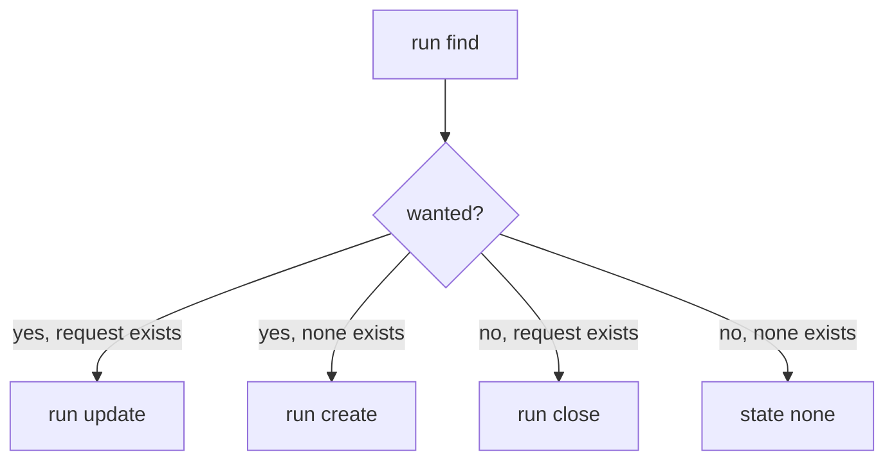

# Review request action

`evin/review-request@v1` keeps at most one open review request (a pull request,
merge request, change, or equivalent) in sync with a branch. It decides whether
the request should be created, refreshed, or closed, and runs configured shell
commands to do it. It has no built-in knowledge of any hosting provider.

It does not calculate versions, write changelogs, commit, tag, or push. Those
belong to neighboring actions:

| Concern | Owner |
| --- | --- |
| Whether anything is releasable | [`evin/version-bumper@v1`](/reference/actions/version-bumper-action) `changed` output |
| Request body text | [`evin/changelog@v1`](/reference/actions/changelog-action) `notes_path` output file |
| Commit, tag, and publishing refs | [`evin/git-release@v1`](/reference/actions/git-release-action) `push` |
| Review request lifecycle | this action |



## Configuration

Unknown fields are rejected.

| `with` field | Type | Default | Contract |
| --- | --- | --- | --- |
| `branch` | string | none | Required. Head branch the request tracks. |
| `base` | string | none | Required. Branch the request targets. |
| `wanted` | boolean | `true` | Whether a request should exist. Wire it to a producer such as `${release:bump.changed}`. |
| `title` | string | none | Required when `wanted` is true. Request title. |
| `body_path` | string | none | Markdown file used as the request body. Must stay inside the workspace. |
| `commands` | object | none | Shell commands described below. `find` is required. |
| `context` | string map | `{}` | Extra values exposed to commands as `EVIN_REVIEW_CONTEXT_<KEY>` variables, for example a version or tag. |

String values pass through the task template context. In a dry run the
action plans the `find` command, marks the run unverified because the current
state of the request is unknown, and executes nothing.

## Commands

Each command is a shell string run through ESH, like a `run:` step, in the
workspace root. Commands see only the task's declared environment plus the
variables below. Values reach commands through the environment, never through
string interpolation, so titles and bodies cannot inject shell syntax.

| Command | Required | Contract |
| --- | --- | --- |
| `find` | yes | Print the identifier of the open request for `branch` (the first non-empty line is used), or nothing when there is none. Exit non-zero only on failure. |
| `create` | no | Create the request. When a request must be created and this is absent, the step fails. |
| `update` | no | Refresh the title and body of the request in `EVIN_REVIEW_ID`. Absent means existing requests are left as they are (state `none`). |
| `close` | no | Close the request in `EVIN_REVIEW_ID`. When a request must be closed and this is absent, the step fails. |

| Variable | Meaning |
| --- | --- |
| `EVIN_REVIEW_BRANCH` | Head branch. |
| `EVIN_REVIEW_BASE` | Base branch. |
| `EVIN_REVIEW_TITLE` | Request title. |
| `EVIN_REVIEW_BODY_FILE` | Absolute path to the body file, when `body_path` is set. |
| `EVIN_REVIEW_ID` | Identifier returned by `find`; set for `update` and `close`. |

## Outputs

| Output | Meaning |
| --- | --- |
| `state` | `created`, `updated`, `closed`, or `none`. |
| `id` | Identifier returned by `find`, when one exists. |

## Example

The GitHub CLI is one possible backend; nothing in the action depends on it.

```flow
tasks:
  propose:
    stage: Publish
    needs: [release:bump, release:changelog, release:prepare]
    env: [GITHUB_TOKEN]
    steps:
      - uses: evin/review-request@v1
        with:
          branch: automation/release
          base: main
          wanted: ${release:bump.changed}
          title: "chore(release): ${release:bump.tag}"
          body_path: target/release-notes.md
          commands:
            find: gh pr list --head "$EVIN_REVIEW_BRANCH" --base "$EVIN_REVIEW_BASE" --state open --json number --jq '.[0].number // empty'
            create: gh pr create --head "$EVIN_REVIEW_BRANCH" --base "$EVIN_REVIEW_BASE" --title "$EVIN_REVIEW_TITLE" --body-file "$EVIN_REVIEW_BODY_FILE"
            update: gh pr edit "$EVIN_REVIEW_ID" --title "$EVIN_REVIEW_TITLE" --body-file "$EVIN_REVIEW_BODY_FILE"
            close: gh pr close "$EVIN_REVIEW_ID" --delete-branch
```

## Failure boundaries

Configuration analysis stays side-effect free: nothing runs until execution. A
non-zero exit from any command fails the step with its exit code and captured
stderr. Publishing the branch happens in an earlier step, so a failing command
leaves a pushed branch that the next run reconciles. The action never deletes
branches itself; removal belongs in `close`.

````lsp
target: [action, evin/review-request@v1]
language: flow
title: Review request action
synopsis: "uses: evin/review-request@v1"
summary: Keep one review request in sync with a branch.
category: action
---
Configure the request and the shell commands that manage it through `with:`.
````

````lsp
target: [action, evin/review-request@v1, with, branch]
language: flow
title: Head branch
synopsis: "branch: automation/release"
summary: Head branch the review request tracks.
category: action-field
---
Required. Accepts pipeline templates. Exposed to commands as `EVIN_REVIEW_BRANCH`.
````

````lsp
target: [action, evin/review-request@v1, with, base]
language: flow
title: Base branch
synopsis: "base: main"
summary: Branch the review request targets.
category: action-field
---
Required. Exposed to commands as `EVIN_REVIEW_BASE`.
````

````lsp
target: [action, evin/review-request@v1, with, wanted]
language: flow
title: Request wanted
synopsis: "wanted: ${release:bump.changed}"
summary: Whether a review request should exist.
category: action-field
---
Boolean or a template resolving to `true` or `false`; defaults to `true`. A wanted request is created or updated, an unwanted one is closed. `title` is required unless `wanted` is literally `false`.
````

````lsp
target: [action, evin/review-request@v1, with, title]
language: flow
title: Request title
synopsis: "title: \"chore(release): ${release:bump.tag}\""
summary: Title of the review request.
category: action-field
---
Required when a request is wanted. Exposed to commands as `EVIN_REVIEW_TITLE`.
````

````lsp
target: [action, evin/review-request@v1, with, body_path]
language: flow
title: Request body file
synopsis: "body_path: target/release-notes.md"
summary: Markdown file used as the request body.
category: action-field
---
Must stay inside the workspace. Commands receive its absolute path as `EVIN_REVIEW_BODY_FILE`.
````

````lsp
target: [action, evin/review-request@v1, with, commands]
language: flow
title: Forge commands
synopsis: "commands: { find: ..., create: ... }"
summary: Shell commands that talk to the hosting provider.
category: action-field
---
Each command is an ESH string. Values reach commands through environment variables, never string interpolation. `find` is required.
````

````lsp
target: [action, evin/review-request@v1, with, commands, find]
language: flow
title: Find command
synopsis: "find: gh pr list --head \"$EVIN_REVIEW_BRANCH\" --json number --jq '.[0].number // empty'"
summary: Print the identifier of the open request, or nothing.
category: action-field
---
Required. The first non-empty stdout line becomes `EVIN_REVIEW_ID` and the `id` output. Exit non-zero only on failure.
````

````lsp
target: [action, evin/review-request@v1, with, commands, create]
language: flow
title: Create command
synopsis: "create: gh pr create --head \"$EVIN_REVIEW_BRANCH\" ..."
summary: Create the review request.
category: action-field
---
Runs when a request is wanted and none exists. The step fails if it is needed but not configured.
````

````lsp
target: [action, evin/review-request@v1, with, commands, update]
language: flow
title: Update command
synopsis: "update: gh pr edit \"$EVIN_REVIEW_ID\" ..."
summary: Refresh the title and body of the existing request.
category: action-field
---
Runs when a request is wanted and one exists. When absent, existing requests are left as they are.
````

````lsp
target: [action, evin/review-request@v1, with, commands, close]
language: flow
title: Close command
synopsis: "close: gh pr close \"$EVIN_REVIEW_ID\""
summary: Close the existing review request.
category: action-field
---
Runs when a request is not wanted and one exists. The step fails if it is needed but not configured. Branch removal belongs here.
````

````lsp
target: [action, evin/review-request@v1, with, context]
language: flow
title: Command context
synopsis: "context: { version: \"${release:bump.version}\" }"
summary: Extra values exposed to commands.
category: action-field
---
Keys may contain letters, digits, and underscores and become `EVIN_REVIEW_CONTEXT_<KEY>` variables, upper-cased.
````
