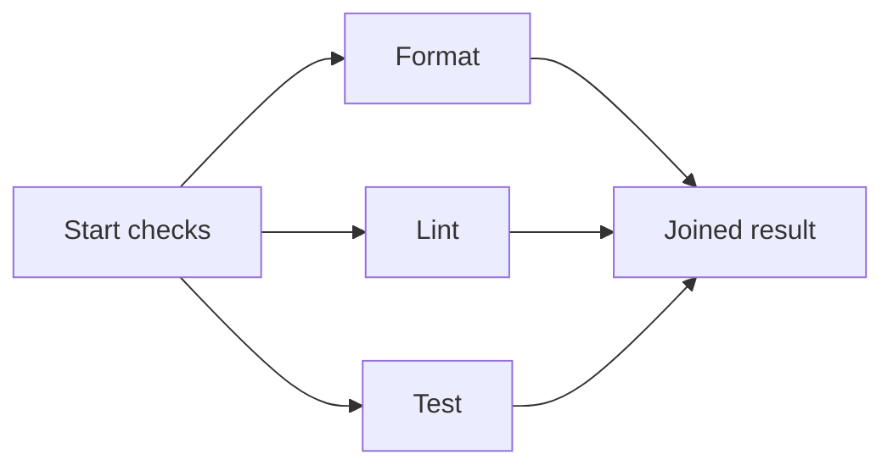

# Parallel automation

Parallelism is useful only when the result stays understandable. Use ESH’s `&|` join for work that has no dependency on the other branches, then handle the joined outcome in one place.

## Join independent checks

```esh
{
  cargo fmt --check &| \
  cargo clippy --all-targets -- -D warnings &| \
  cargo test
} || {
  echo "Checks failed in $ESH_FAILED_CMD at line $ESH_FAILED_LINE" >&2
  exit 1
}
```

Each branch begins independently; the enclosing expression completes only after the joined work has completed. Keep work sequential when one command consumes another command’s output or files.



## Put a boundary around slow work

Use `timeout` when a command needs a deadline and `retry` when failure can be transient. Both return a normal status, so they fit naturally inside the same joined workflow.

```esh
timeout 30s cargo test
retry -n 3 -d 2s http GET http://127.0.0.1:8080/health
```

`timeout` returns `124` when its deadline expires. `retry` returns a non-zero status after its final failed attempt. Their exact contracts are in the [ESH Runtime Reference](/reference/esh/runtime-reference).

Next: adapt a complete pattern from [ESH automation recipes](/reference/esh/automation-recipes).
